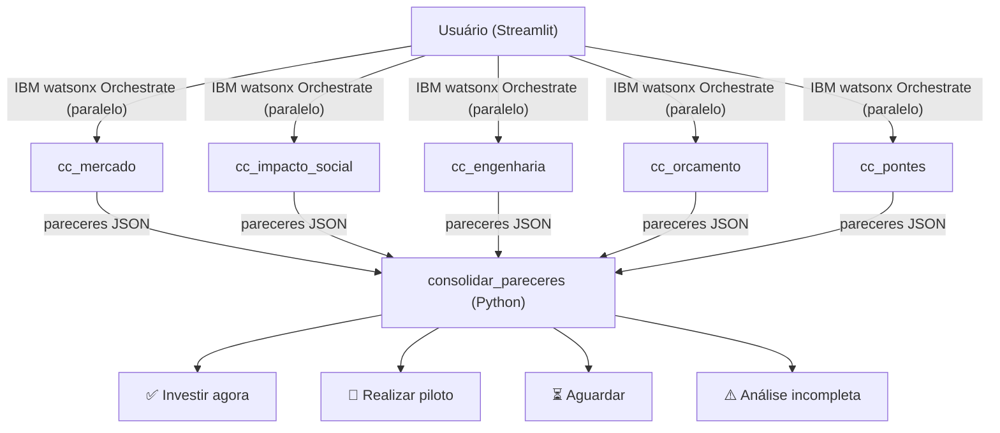

# Conecta Conselho

Sistema multiagente que apoia decisões de expansão de conectividade em regiões brasileiras fictícias, avaliando viabilidade técnica, financeira, social e de parcerias antes de recomendar uma ação.

> ⚠️ **Todos os dados são FICTÍCIOS e SIMULADOS.** Nenhum indicador representa município, estado ou região real do Brasil.

**🔗 Protótipo público:** https://conecta-conselho.streamlit.app

---

## O problema

Operadoras precisam priorizar onde expandir conectividade, conciliando viabilidade comercial, restrições de infraestrutura, orçamento e benefício social. Uma análise isolada pode favorecer áreas rentáveis e ignorar localidades desassistidas. O Conecta Conselho reúne perspectivas especializadas e testa se instituições âncora — escolas, unidades de saúde e outros equipamentos públicos — poderiam melhorar o cenário de atendimento. O sistema **apoia** a triagem de oportunidades, mas **não autoriza** obras nem substitui análise de campo.

---

## Fluxo



Os 5 agentes são chamados em paralelo via `ThreadPoolExecutor`. A consolidação é feita localmente em Python por `consolidar_pareceres` (`tools/tool_guardiao.py`) — nunca pelo LLM.

---

## Agentes

| Agente | Nome no workspace | Pergunta que responde | Tool Python | YAML |
|---|---|---|---|---|
| Mercado | `cc_mercado` | Vale a pena financeiramente? | `tools/tool_mercado.py` | `agents/agente_mercado.yaml` |
| Impacto Social | `cc_impacto_social` | Quem ganha com a conexão? | `tools/tool_social.py` | `agents/agente_social.yaml` |
| Engenharia | `cc_engenharia` | Dá para construir? | `tools/tool_engenharia.py` | `agents/agente_engenharia.yaml` |
| Orçamento | `cc_orcamento` | Cabe no limite de custo e prazo? | `tools/tool_orcamento.py` | `agents/agente_orcamento.yaml` |
| Pontes | `cc_pontes` | Dá para tornar a região viável? | `tools/tool_pontes.py` | `agents/agente_pontes.yaml` |

---

## Páginas do app

| Página | Descrição |
|---|---|
| **📖 Como funciona** | Página inicial interativa — apresenta os agentes, sliders para brincar com o Guardião ao vivo e legenda das recomendações |
| **🔍 Análise de Região** | Executa os 5 agentes (IBM ou local), exibe pareceres, recomendação, alerta de atenção prioritária, motivos e caminhos, ranking da sessão e download do relatório JSON |
| **🗺️ Mapa ilustrativo** | Visualização das regiões e recomendações em mapa esquemático |
| **🧪 Simulador de cenários** | "E se…?" — simula impacto de parcerias, teto de investimento e distância do backbone; prova que Esperança vai de 44 (Aguardar) → 50 (Piloto) com parcerias |

---

## Estrutura de pastas

```
inteli_girls/
├── agents/                    # YAMLs dos agentes ADK
├── tools/                     # Ferramentas Python dos agentes (tool_<nome>.py)
├── scripts/                   # Scripts de publicação e teste na nuvem
├── conecta-conselho/
│   ├── app.py                 # Roteador Streamlit (st.navigation)
│   ├── integracao.py          # Camada multi-fonte (local / nuvem)
│   ├── cliente_nuvem.py       # Conexão IBM watsonx Orchestrate
│   ├── simulador.py           # Motor de cenários determinístico
│   ├── paginas/               # Uma página por arquivo (como_funciona, analise, mapa, simulador)
│   ├── data/                  # regioes.json e regioes.csv (dados simulados)
│   ├── models/                # Modelos Pydantic (regiao.py)
│   ├── tools/                 # consultar_regiao.py (consultas compartilhadas)
│   ├── tests/                 # Testes automatizados (1 009 testes)
│   └── docs/                  # Documentação do projeto
├── requirements.txt
└── pytest.ini
```

---

## Como rodar localmente (Windows / PowerShell)

> **Pré-requisito:** Python 3.12.x — verifique antes de começar:
> ```powershell
> python --version   # precisa exibir Python 3.12.x
> ```

> **PowerShell — política de execução:** em PCs novos ou corporativos, o PowerShell pode bloquear scripts `.ps1`. Se o comando de ativação falhar, rode primeiro:
> ```powershell
> Set-ExecutionPolicy -ExecutionPolicy RemoteSigned -Scope CurrentUser
> ```

```powershell
git clone --branch main https://github.com/LauraRodrigues31/inteli_girls.git
cd inteli_girls

python -m venv venv
venv\Scripts\Activate.ps1

pip install -r requirements.txt
python -m pytest -q
```

A suíte completa tem **mais de 1 000 testes automatizados** e todos devem passar.

### Interface Streamlit

```powershell
# Com o venv ativo:
python -m streamlit run conecta-conselho/app.py
```

> Rodar fora do venv causa erro de módulo do ADK.

Fonte dos pareceres (barra lateral):

- **IBM watsonx Orchestrate**: vira o padrão quando `WXO_URL`, `WXO_API_KEY` e os 5 `CC_AGENT_ID_*` estão definidos. Resultados da nuvem ficam em cache por 6 h por região; o botão **🔄 Consultar a IBM novamente** ignora o cache. Análises incompletas nunca ficam em cache.
- **Local**: cálculos determinísticos sem nuvem. É o padrão quando faltam credenciais ou IDs, e o plano B se a nuvem falhar (botão **🖥️ Analisar no modo Local**).

As variáveis são lidas primeiro do ambiente do processo (`os.environ`) e depois do `.env` na raiz.

#### Cartografia fictícia

O mapa da Análise de Região e do Simulador lê `conecta-conselho/data/territorio_ficticio.geojson`.
As feições são organizadas por `properties.camada`, incluindo regiões, litoral, rios,
vias, áreas protegidas, relevo, núcleos urbanos e fibra. Para regenerar o arquivo
a partir da malha de referência, na raiz do projeto execute:

```powershell
python scripts/gerar_geografia_ficticia.py
```

O gerador usa apenas a biblioteca padrão do Python. A semente é fixa, e cada
trecho compartilhado é detalhado uma vez e reutilizado pelas regiões vizinhas.
O arquivo GeoJSON usa uma origem angular fictícia em `(0, 0)`, codificando a
malha local como `[x / 1000, -y / 1000]`. O componente converte esses valores
de volta para o plano de desenho. Por isso, a carta tem orientação norte e
zoom, mas não usa escala em quilômetros. As distâncias e os indicadores
exibidos são os da base simulada. Todas as camadas são locais.

### Deploy no Streamlit Cloud

1. Em *Create app*, aponte para este repositório, branch `main` e arquivo `conecta-conselho/app.py`.
2. Em *Advanced settings*, escolha **Python 3.12**.
3. Em *Secrets*, cole as variáveis no nível raiz do TOML (o Streamlit as expõe como variáveis de ambiente):

```toml
WXO_URL = "https://..."
WXO_API_KEY = "..."
CC_AGENT_ID_MERCADO = "..."
CC_AGENT_ID_SOCIAL = "..."
CC_AGENT_ID_ENGENHARIA = "..."
CC_AGENT_ID_ORCAMENTO = "..."
CC_AGENT_ID_PONTES = "..."
```

Sem os Secrets, o app sobe normalmente no modo Local.

---

## Como as decisões são calculadas

Os scores vêm de **funções Python determinísticas**, nunca do LLM. O Guardião calcula a média ponderada dos cinco pareceres:

| Agente | Peso |
|---|---|
| Engenharia | 25% |
| Orçamento | 25% |
| Mercado | 20% |
| Impacto Social | 20% |
| Pontes | 10% |

Critérios de recomendação:

| Recomendação | Critério |
|---|---|
| **Investir agora** | `score_consolidado ≥ 70` **E** `orcamento ≥ 60` **E** `engenharia ≥ 60` |
| **Realizar piloto** | `score_consolidado ≥ 50` e não atende critérios acima |
| **Aguardar** | `30 ≤ score_consolidado < 50` |
| **⚠️ Análise incompleta** | Algum agente retornou erro, confiança baixa, `score < 20` em orçamento ou engenharia, ou `score_consolidado < 30` |

O **Alerta de Atenção Prioritária** é acionado quando os pontos críticos indicam risco elevado mesmo dentro de uma recomendação válida (ex.: Nova União — aguardar com alerta).

> ⚠️ Os pesos e limiares acima são **hipóteses do MVP** para fins de demonstração. Não representam metodologia real de decisão de investimento.

Resultados por região: [RESULTADOS_REGIOES.md](conecta-conselho/docs/RESULTADOS_REGIOES.md)

---

## Capturas de tela

[PRINTS]

---

## Publicação na IBM

A publicação no watsonx Orchestrate é feita por uma única pessoa do grupo. Veja [conecta-conselho/docs/GUIA_PUBLICACAO_AGENTES.md](conecta-conselho/docs/GUIA_PUBLICACAO_AGENTES.md).

---

## Limitações

- Todos os dados são simulados e fictícios; nenhum indicador representa localidade real.
- O sistema **apoia a triagem** de oportunidades — não autoriza investimentos, obras ou contratos.
- Não substitui análise de campo, regulação ou negociação comercial.

---

## Equipe

Laura Rodrigues · Ana Beggiato · Milena Castro · Gabriela Silva · Thalyta Viana
Trilha 3 · Telecomunicações inteligentes com **Fundação Telefônica**  
AI Experiential Learning Lab · **IBM SkillsBuild**
