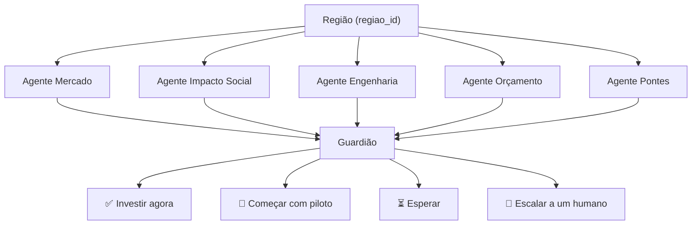

# Conecta Conselho

Sistema multiagente que apoia decisões de expansão de conectividade em regiões brasileiras fictícias, avaliando viabilidade técnica, financeira, social e de parcerias antes de recomendar uma ação.

> ⚠️ **Todos os dados são FICTÍCIOS e SIMULADOS.** Nenhum indicador representa município, estado ou região real do Brasil.

---

## O problema

Operadoras precisam priorizar onde expandir conectividade, conciliando viabilidade comercial, restrições de infraestrutura, orçamento e benefício social. Uma análise isolada pode favorecer áreas rentáveis e ignorar localidades desassistidas. O Conecta Conselho reúne perspectivas especializadas e testa se instituições âncora — escolas, unidades de saúde e outros equipamentos públicos — poderiam melhorar o cenário de atendimento. O sistema **apoia** a triagem de oportunidades, mas **não autoriza** obras nem substitui análise de campo.

---

## Fluxo



---

## Agentes

| Agente | Nome no workspace | Pergunta que responde | Tool Python | YAML |
|---|---|---|---|---|
| Mercado | `cc_mercado` | Vale a pena financeiramente? | `tools/tool_mercado.py` | `agents/agente_mercado.yaml` |
| Impacto Social | `cc_impacto_social` | Quem ganha com a conexão? | `tools/tool_social.py` | `agents/agente_social.yaml` |
| Engenharia | `cc_engenharia` | Dá para construir? | `tools/tool_engenharia.py` | `agents/agente_engenharia.yaml` |
| Orçamento | `cc_orcamento` | Cabe no limite de custo e prazo? | `tools/tool_orcamento.py` | `agents/agente_orcamento.yaml` |
| Pontes | `cc_pontes` | Dá para tornar a região viável? | `tools/tool_pontes.py` | `agents/agente_pontes.yaml` |
| Guardião | `cc_guardiao` | O que fazemos? | `tools/tool_guardiao.py` | `agents/agente_guardiao.yaml` |

---

## Estrutura de pastas

```
inteli_girls/
├── agents/          # YAMLs dos agentes ADK
├── tools/           # Ferramentas Python dos agentes (tool_<nome>.py)
├── conecta-conselho/
│   ├── data/        # regioes.json e regioes.csv (dados simulados)
│   ├── models/      # Modelos Pydantic (regiao.py)
│   ├── tools/       # consultar_regiao.py (consultas compartilhadas)
│   ├── tests/       # Testes automatizados
│   └── docs/        # Documentação do projeto
├── requirements.txt
└── pytest.ini
```

---

## Como rodar localmente (Windows / PowerShell)

> **Pré-requisito:** Python 3.12.x — verifique antes de começar:
> ```powershell
> python --version   # precisa exibir Python 3.12.x
> ```

> **PowerShell — política de execução:** em PCs novos ou corporativos, o PowerShell pode bloquear scripts `.ps1`. Se o comando de ativação falhar, rode primeiro:
> ```powershell
> Set-ExecutionPolicy -ExecutionPolicy RemoteSigned -Scope CurrentUser
> ```

```powershell
git clone --branch main https://github.com/LauraRodrigues31/inteli_girls.git
cd inteli_girls

python -m venv .venv
.venv\Scripts\Activate.ps1

pip install -r requirements.txt
python -m pytest -q
```

A suíte completa tem **mais de 750 testes** (incluindo os 204 da base de dados) e todos devem passar.

### Rodar uma tool isolada

O exemplo abaixo invoca `montar_parecer` do Agente Engenharia para a Região Aurora:

```powershell
.venv\Scripts\python.exe -c "
import sys, importlib.util
sys.path.insert(0, 'conecta-conselho')
spec = importlib.util.spec_from_file_location('tool_engenharia', 'tools/tool_engenharia.py')
mod = importlib.util.module_from_spec(spec)
spec.loader.exec_module(mod)
import json; print(json.dumps(mod.montar_parecer('aurora'), ensure_ascii=False, indent=2))
"
```

> O `sys.path.insert(0, 'conecta-conselho')` é necessário porque o workspace tem dois pacotes `tools/` — um na raiz (ferramentas ADK) e outro em `conecta-conselho/tools/` (consultas compartilhadas). O Python do `.venv` já tem o ADK instalado.

### Interface Streamlit

```powershell
python -m streamlit run conecta-conselho/app.py
```

(com o ambiente virtual ativo; abrir fora do venv causa erro de módulo do ADK)

Modo padrão: local (cálculos determinísticos, sem nuvem).

---

## Como as decisões são calculadas

Os scores vêm de **funções Python determinísticas**, nunca do LLM. O Guardião calcula a média ponderada dos cinco pareceres:

| Agente | Peso |
|---|---|
| Engenharia | 25% |
| Orçamento | 25% |
| Mercado | 20% |
| Impacto Social | 20% |
| Pontes | 10% |

Critérios de recomendação (Seção 11 do [PADRAO_DESENVOLVIMENTO_AGENTES.md](conecta-conselho/docs/PADRAO_DESENVOLVIMENTO_AGENTES.md)):

| Recomendação | Critério |
|---|---|
| **Investir agora** | `score_consolidado ≥ 70` **E** `orcamento ≥ 60` **E** `engenharia ≥ 60` |
| **Começar com piloto** | `score_consolidado ≥ 50` e NÃO atende critérios acima |
| **Esperar** | `30 ≤ score_consolidado < 50` |
| **Escalar a um humano** | `score_consolidado < 30`, OU `engenharia < 20`, OU `orcamento < 20`, OU algum parecer com erro ou confiança baixa |

Esse escalonamento garante que casos bloqueados ou com dados incertos sejam decididos por uma pessoa.

> ⚠️ Os pesos e limiares acima são **hipóteses do MVP** para fins de demonstração. Não representam metodologia real de decisão de investimento.

Resultados por região: [RESULTADOS_REGIOES.md](conecta-conselho/docs/RESULTADOS_REGIOES.md)

---

## Publicação na IBM

A publicação no watsonx Orchestrate é feita por uma única pessoa do grupo. Veja [conecta-conselho/docs/GUIA_PUBLICACAO_AGENTES.md](conecta-conselho/docs/GUIA_PUBLICACAO_AGENTES.md).

---

## Limitações

- Todos os dados são simulados e fictícios; nenhum indicador representa localidade real.
- O sistema **apoia a triagem** de oportunidades — não autoriza investimentos, obras ou contratos.
- Não há mapas, geolocalização nem geoprocessamento.
- Não substitui análise de campo, regulação ou negociação comercial.

---

## Equipe

Laura Rodrigues · Ana Beggiato · Milena Castro · Gabriela Silva · Thalyta Viana
Trilha 3 · Telecomunicações inteligentes com **Fundação Telefônica**  
AI Experiential Learning Lab · **IBM SkillsBuild**
