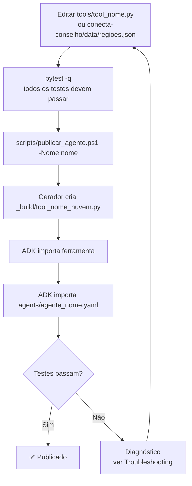

# Guia de Publicação de Agentes — Conecta Conselho

> **Projeto:** Conecta Conselho — Piloto de Agentes de IA
> **Plataforma:** IBM watsonx Orchestrate (SaaS, região `jp-tok`)
> **Instância:** lida de `WXO_URL` no `.env`
> **Última atualização:** Etapa 4 concluída — todos os 4 testes passaram ✅

> ⚠️ **PUBLICAÇÃO É RESPONSABILIDADE EXCLUSIVA DA LAURA.**
> Nenhuma outra integrante deve rodar `scripts\publicar_agente.ps1`, `orchestrate tools import` nem `orchestrate agents import`.
> As demais integrantes contribuem com o código e os testes locais; a publicação no watsonx Orchestrate é centralizada.

---

## Índice

1. [Pré-requisitos](#1-pré-requisitos)
2. [Estrutura de Pastas](#2-estrutura-de-pastas)
3. [Por que existe um gerador](#3-por-que-existe-um-gerador)
4. [Fluxo de Publicação](#4-fluxo-de-publicação)
5. [Publicação via Script (recomendado)](#5-publicação-via-script-recomendado)
6. [Publicação Manual (passo a passo)](#6-publicação-manual-passo-a-passo)
7. [Testando o Agente Após Publicação](#7-testando-o-agente-após-publicação)
   - [Pela tela (Agent Builder → Preview)](#71-pela-tela-agent-builder--preview)
   - [Pela API de Runtime (recomendado no Windows)](#72-pela-api-de-runtime-recomendado-no-windows)
   - [⚠ Por que NÃO usar `orchestrate chat ask`](#73--por-que-não-usar-orchestrate-chat-ask)
8. [Resultados dos testes (Etapa 4 — cc_engenharia)](#8-resultados-dos-testes-etapa-4--cc_engenharia)
9. [Limitações conhecidas](#9-limitações-conhecidas)
10. [Regras do workspace compartilhado](#10-regras-do-workspace-compartilhado)
11. [Troubleshooting Rápido](#11-troubleshooting-rápido)

---

## 1. Pré-requisitos

| Item | Detalhe |
|------|---------|
| Python | ≥ 3.11, < 3.15 |
| ADK | `ibm-watsonx-orchestrate` ≥ 2.19 (`.venv\Scripts\orchestrate.exe`) |
| Credenciais | `WXO_API_KEY` no arquivo `.env` (gitignored) |
| Ambiente ativo | `conecta-conselho` (SaaS jp-tok) |

**Verificar pré-condições:**
```powershell
.venv\Scripts\orchestrate.exe --version
.venv\Scripts\orchestrate.exe env list
.venv\Scripts\orchestrate.exe agents list
```

---

## 2. Estrutura de Pastas

```
inteli_girls/
├── _build/                              # Artefatos de build (gitignored)
│   └── tool_<nome>_nuvem.py            # Gerado automaticamente — não editar à mão
├── agents/                              # YAMLs dos agentes (versionados)
│   ├── agente_engenharia.yaml
│   ├── agente_mercado.yaml
│   ├── agente_social.yaml
│   ├── agente_orcamento.yaml
│   └── agente_pontes.yaml
├── tools/                               # Ferramentas originais (versionadas)
│   ├── tool_engenharia.py
│   ├── tool_mercado.py
│   ├── tool_social.py
│   ├── tool_orcamento.py
│   └── tool_pontes.py
├── conecta-conselho/
│   ├── data/
│   │   └── regioes.json                # Base de dados canônica
│   ├── docs/
│   │   └── GUIA_PUBLICACAO_AGENTES.md  ← este arquivo
│   └── tests/
│       └── test_ferramentas_nuvem.py   # Testa paridade original ↔ nuvem
└── scripts/
    ├── gerar_ferramenta_nuvem.py       # Gerador de versões self-contained
    ├── publicar_agente.ps1             # Publica ferramenta + agente no Orchestrate
    └── testar_agente_nuvem.py          # Testa qualquer agente via API de runtime
```

---

## 3. Por que existe um gerador

### O problema descoberto no piloto

Durante a Etapa 4 do piloto (cc_engenharia), a ferramenta publicada falhou com:

```
"erro": "Falha ao executar a ferramenta de análise de engenharia. O módulo necessário não foi encontrado."
```

A causa raiz: as ferramentas em `tools/tool_<nome>.py` usam `sys.path.insert` ou `importlib` para importar funções de `conecta-conselho/tools/consultar_regiao.py`. Isso funciona localmente, mas **o runtime em nuvem do IBM watsonx Orchestrate executa cada ferramenta em um ambiente isolado, sem acesso ao sistema de arquivos do desenvolvedor**. O import falha com `ModuleNotFoundError`.

### A solução: geração automática

Em vez de editar as ferramentas à mão (que quebra o versionamento e cria divergência entre o que é testado e o que está publicado), o gerador [`scripts/gerar_ferramenta_nuvem.py`](../../scripts/gerar_ferramenta_nuvem.py):

1. Lê `conecta-conselho/data/regioes.json` e embute os dados como dicionário Python
2. Substitui as funções de `consultar_regiao.py` por versões que lêem do dicionário embutido
3. Copia o corpo de `tools/tool_<nome>.py` **sem alterar nenhuma linha de lógica** — apenas remove os blocos de `sys.path`/importlib

O resultado em `_build/tool_<nome>_nuvem.py` é **completamente self-contained** e produz **saída idêntica** à ferramenta original (verificado pelo teste `test_ferramentas_nuvem.py`).

**Regra:** nunca edite os arquivos `_build/tool_*_nuvem.py` à mão. Se precisar mudar a lógica, edite `tools/tool_<nome>.py` e regenere com o script.

---

## 4. Fluxo de Publicação



---

## 5. Publicação via Script (somente Laura)

> ⚠️ **Apenas a Laura deve executar estes comandos.** As demais integrantes não devem rodar `publicar_agente.ps1` nem comandos `orchestrate` de import ou remove.

```powershell
# Na raiz do workspace — executar SOMENTE como Laura
scripts\publicar_agente.ps1 -Nome engenharia

# Outros agentes
scripts\publicar_agente.ps1 -Nome mercado
scripts\publicar_agente.ps1 -Nome social
scripts\publicar_agente.ps1 -Nome orcamento
scripts\publicar_agente.ps1 -Nome pontes
```

O script:
1. Lê `WXO_API_KEY` do `.env` sem exibi-la no terminal
2. Ativa o ambiente `conecta-conselho`
3. Gera `_build/tool_<nome>_nuvem.py` chamando o gerador
4. Importa a ferramenta com `orchestrate tools import -k python`
5. Importa o agente com `orchestrate agents import -f agents/agente_<nome>.yaml`
6. Lista artefatos e imprime instruções de teste

**Nomes válidos:** `engenharia`, `mercado`, `social`, `orcamento`, `pontes`

---

## 6. Publicação Manual (passo a passo)

### 6.1 Ativar ambiente

```powershell
$key = (Get-Content .env | Where-Object { $_ -match '^WXO_API_KEY=' }) -replace '^WXO_API_KEY=',''
.venv\Scripts\orchestrate.exe env activate conecta-conselho --api-key $key
```

### 6.2 Gerar ferramenta self-contained

```powershell
$env:PYTHONIOENCODING = "utf-8"
python scripts\gerar_ferramenta_nuvem.py engenharia
# Gera: _build/tool_engenharia_nuvem.py
```

### 6.3 Importar ferramenta

```powershell
.venv\Scripts\orchestrate.exe tools import -k python -f _build\tool_engenharia_nuvem.py
```

O ADK pode exibir um aviso sobre type hints — é um **falso positivo** do ADK 2.19, pode ignorar.

### 6.4 Importar agente

```powershell
.venv\Scripts\orchestrate.exe agents import -f agents\agente_engenharia.yaml
```

### 6.5 Verificar

```powershell
.venv\Scripts\orchestrate.exe tools list
.venv\Scripts\orchestrate.exe agents list
```

---

## 7. Testando o Agente Após Publicação

### 7.1 Pela tela (Agent Builder → Preview)

1. Acesse https://jp-tok.watson-orchestrate.cloud.ibm.com
2. Menu lateral → **Agent Builder**
3. Clique no agente (ex: `cc_engenharia`)
4. Botão **Preview** (canto superior direito)
5. Envie os prompts de teste (exemplo para engenharia):

| Prompt | Score esperado | Confiança esperada |
|--------|---------------|-------------------|
| `Analise a engenharia da região central` | calculado pela ferramenta local | alta |
| `Analise a região nova_uniao` | calculado pela ferramenta local | alta |
| `Analise a região atlantida` | 0 | nao_avaliada |

**O que verificar:**
- Campo `score` no JSON retornado igual ao calculado pela ferramenta local
- Campo `confianca` (alta / nao_avaliada)
- Campo `erro` preenchido para região inexistente

---

### 7.2 Pela API de Runtime (recomendado no Windows)

Use o script versionado que funciona para qualquer um dos 5 agentes:

```powershell
$env:PYTHONIOENCODING = "utf-8"
python scripts\testar_agente_nuvem.py engenharia   # ou mercado, social, orcamento, pontes
```

O que o script faz:
- Lê `WXO_URL` do `.env` (sem hardcode de instância)
- Descobre o `agent_id` via `orchestrate agents list -v` (sem hardcode de UUID)
- Calcula os scores esperados rodando a ferramenta local
- Executa 3 testes contra o endpoint de runtime e imprime tabela ✅/❌

**Endpoint utilizado (formato geral):**
```
POST <WXO_URL>/v1/orchestrate/<agent_id>/chat/completions
```

**Body mínimo:**
```json
{ "stream": false, "messages": [{"role": "user", "content": "<pergunta>"}] }
```

Se aparecer erro de autenticação, o script imprime:
```
Login expirado: rode orchestrate env activate conecta-conselho --api-key <sua key>
```

---

### 7.3 ⚠ Por que NÃO usar `orchestrate chat ask`

O comando `orchestrate chat ask` **trava no Windows** com o erro:

```
EOF when reading a line
```

Isso ocorre porque o CLI abre um prompt interativo que aguarda input do terminal — o que não funciona em sessões não-interativas (PowerShell, pipelines, CI). O loop é infinito e a única saída é `Ctrl+C`.

**Alternativas:**
- ✅ Tela (Agent Builder → Preview) — mais simples para testes manuais
- ✅ API de Runtime com Python — automatizável, reproduzível
- ✅ IBM Bob (chat com o agente direto no IDE)

---

## 8. Resultados dos testes (Etapa 4 — cc_engenharia)

Testes executados via `_build/test_cc_engenharia.py` contra o endpoint de runtime da instância SaaS
(`jp-tok`), agente `cc_engenharia` (id `22960685-5461-4fbd-96cd-adf2518efcde`):

| Status | Teste | Score esperado | Score obtido | Observação |
|--------|-------|---------------|-------------|------------|
| ✅ PASS | T1 – `central` | 86 | **86** | `confianca: alta`, `erro: null` |
| ✅ PASS | T2 – `nova_uniao` | 11 | **11** | `confianca: alta`, `erro: null` |
| ✅ PASS | T3 – `atlantida` (inválida) | 0 | **0** | `confianca: nao_avaliada`, `erro` preenchido |
| ✅ PASS | T4 – multi-turn "risco técnico" | contexto | resposta contextual | Ver nota abaixo |

**Nota sobre T4:** O agente pediu confirmação da região em vez de usar o contexto de T1 diretamente.
Isso é esperado: a resposta de T1 é JSON puro, e o LLM não consegue inferir "dela" de um bloco JSON.
No fluxo real, o Guardião sempre passa `regiao_id` explicitamente — sem dependência de contexto implícito.

**Script de teste:** [`_build/test_cc_engenharia.py`](../../_build/test_cc_engenharia.py) — rode com:

```powershell
$env:PYTHONIOENCODING = "utf-8"
.venv\Scripts\python.exe _build\test_cc_engenharia.py
```

---

## 9. Limitações conhecidas

### 9.1 Agente devolve JSON bruto (por design)

Durante os testes da Etapa 4, observou-se que o agente devolve o JSON completo da ferramenta em vez de uma resposta formatada em linguagem natural. Isso é **comportamento esperado e intencional**: o Guardião (agente orquestrador) precisa do JSON estruturado para fazer a consolidação dos pareceres de todos os agentes especialistas. Se o agente reformatar o texto, o Guardião perde os campos `score`, `confianca`, `riscos`, etc.

Para uma resposta em linguagem natural ao usuário final, o Guardião fará essa formatação ao consolidar os pareceres.

### 9.2 Multi-turn com JSON bruto

O teste T4 (multi-turn: "E qual o principal risco técnico dela?") passou no critério funcional, mas o agente pediu confirmação da região em vez de usar o contexto da conversa anterior. Isso ocorre porque a resposta anterior era JSON puro — o LLM não consegue referenciar "ela" em um bloco JSON. Este comportamento é aceitável no contexto do Guardião (que passa o `regiao_id` explicitamente em cada chamada).

### 9.3 Diferença de mensagem de erro para regiões inexistentes

A ferramenta gerada usa `"Nenhuma região com id 'X' foi encontrada..."` (de `_regiao_nao_encontrada`). Os campos funcionais (`score=0`, `confianca=nao_avaliada`, `erro não nulo`) são idênticos entre original e gerada — a diferença é apenas no texto da mensagem, sem impacto no Guardião.

---

## 10. Regras do workspace compartilhado

| Regra | Detalhe |
|-------|---------|
| **Publicação é exclusiva da Laura** | Somente a Laura executa `scripts\publicar_agente.ps1`, `orchestrate tools import` ou `orchestrate agents import`. As demais integrantes **não devem rodar esses comandos**. |
| **Nunca rode `orchestrate chat ask`** | Trava o terminal no Windows com EOF infinito. Use Agent Builder → Preview ou a API REST. |
| **Não edite `_build/tool_*_nuvem.py` à mão** | Esses arquivos são gerados automaticamente. Edições manuais serão sobrescritas na próxima publicação. |
| **Rode pytest antes de publicar** | `python -m pytest -q` deve passar 100% antes de qualquer publicação — responsabilidade da Laura antes de cada deploy. |

---

## 11. Troubleshooting Rápido

| Sintoma | Causa provável | Solução |
|---------|---------------|---------|
| `"O módulo necessário não foi encontrado."` | Ferramenta não gerada pelo gerador | Rodar `scripts\publicar_agente.ps1 -Nome <nome>` — usa versão self-contained |
| `orchestrate chat ask` trava | CLI interativo, EOF no Windows | Usar API REST ou Agent Builder Preview |
| `401 Unauthorized` na API | Token expirado | Rodar `publicar_agente.ps1` (reativa o ambiente) |
| `404` no endpoint | Segmento `/orchestrate` ausente | URL deve conter `/v1/orchestrate/<agent_id>/chat/completions` |
| Score diferente do esperado | `regioes.json` foi alterado mas `_nuvem.py` não foi regenerado | Publicar novamente com `publicar_agente.ps1` |
| Agente não chama a ferramenta | Instructions vagas | Reforçar instructions do agente: "SEMPRE chame `analisar_<nome>`" |
| ADK warning em `tools import` | Falso positivo do ADK 2.19 para tipos dict | Ignorar — a ferramenta importa e executa corretamente |
| `No agents with the name 'X'` | Usando display name, não snake_case | `orchestrate agents list -v` para ver o nome correto |
| Agente aparece mas não responde | YAML correto é `agents/agente_<nome>.yaml` (não `conecta-conselho/agents/`) | Verificar que o import aponta para `agents/` na raiz |
