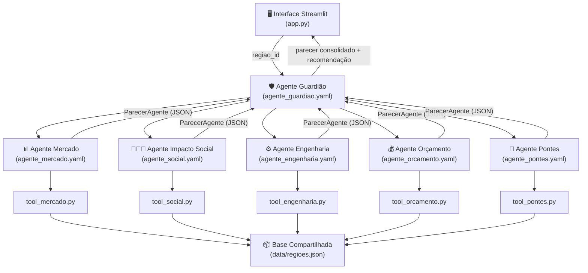

# PADRÃO DE DESENVOLVIMENTO — Conecta Conselho

> **Fonte única de verdade para o desenvolvimento do MVP.**
> Versão: 1.0.0 | Sistema: Conecta Conselho | Público: cinco integrantes da equipe de desenvolvimento
>
> ⚠️ **Todos os dados da base simulada são FICTÍCIOS.** Não representam indicadores reais de nenhuma região do Brasil.

---

## Sumário

1. [Visão Geral e Arquitetura](#1-visão-geral-e-arquitetura)
2. [Regras Obrigatórias para Todos](#2-regras-obrigatórias-para-todos)
3. [Contrato de Entrada e Saída dos Agentes](#3-contrato-de-entrada-e-saída-dos-agentes)
4. [Regras de Integração com a Base de Dados](#4-regras-de-integração-com-a-base-de-dados)
5. [Estrutura Oficial do Repositório](#5-estrutura-oficial-do-repositório)
6. [Prompt Oficial — Agente Mercado](#6-prompt-oficial--agente-mercado)
7. [Prompt Oficial — Agente Impacto Social](#7-prompt-oficial--agente-impacto-social)
8. [Prompt Oficial — Agente Engenharia](#8-prompt-oficial--agente-engenharia)
9. [Prompt Oficial — Agente Orçamento](#9-prompt-oficial--agente-orçamento)
10. [Prompt Oficial — Agente Pontes](#10-prompt-oficial--agente-pontes)
11. [Prompt Oficial — Agente Guardião](#11-prompt-oficial--agente-guardião)
12. [Prompt Oficial — Interface Streamlit](#12-prompt-oficial--interface-streamlit)
13. [GitHub e Colaboração](#13-github-e-colaboração)
14. [Testes Obrigatórios](#14-testes-obrigatórios)
15. [Cronograma de Uma Semana](#15-cronograma-de-uma-semana)
16. [Critérios de Conclusão](#16-critérios-de-conclusão)

---

## 1. Visão Geral e Arquitetura

### 1.1 Objetivo do MVP

O **Conecta Conselho** é um sistema multiagente que apoia decisões de expansão de conectividade em regiões brasileiras fictícias. Dado o identificador de uma região, o sistema produz uma análise estruturada em cinco perspectivas independentes e uma recomendação consolidada.

O MVP não implementa mapas, geolocalização, análise espacial, comparação geográfica nem otimização de investimentos.

### 1.2 Agentes e Responsabilidades

| Agente | Perspectiva | Responsável | Ferramenta principal |
|---|---|---|---|
| **Mercado** | Potencial econômico e demanda | Integrante 1 | `consultar_mercado(id)` |
| **Impacto Social** | Benefícios sociais da conectividade | Integrante 2 | `consultar_social(id)` |
| **Engenharia** | Viabilidade técnica de implantação | Integrante 3 | `consultar_engenharia(id)` |
| **Orçamento** | Custos, retorno e restrições financeiras | Integrante 4 | `consultar_financeiro(id)` |
| **Pontes** | Parcerias e compartilhamento de infraestrutura | Integrante 5 | `consultar_parcerias(id)` |
| **Guardião** | Consolidação e recomendação final | Compartilhado | Todos os cinco agentes acima |

### 1.3 Fluxo de Execução

1. O usuário seleciona uma região na interface Streamlit.
2. O Streamlit envia `regiao_id` ao agente Guardião.
3. O Guardião invoca os cinco agentes especialistas em paralelo ou sequência.
4. Cada agente consulta a base via `tools/consultar_regiao.py` e retorna seu parecer no formato do contrato padrão (Seção 3).
5. O Guardião consolida os cinco pareceres, identifica divergências e produz uma recomendação.
6. O Streamlit exibe os resultados organizados por perspectiva e a recomendação final.

### 1.4 Diagrama de Arquitetura



### 1.5 Componentes Existentes (implementados)

| Componente | Caminho | Status |
|---|---|---|
| Base de dados simulada | `conecta-conselho/data/regioes.json` | ✅ Implementado |
| Modelos Pydantic | `conecta-conselho/models/regiao.py` | ✅ Implementado |
| Funções de consulta | `conecta-conselho/tools/consultar_regiao.py` | ✅ Implementado |
| Testes da base | `conecta-conselho/tests/test_dados_regioes.py` | ✅ Implementado (204 testes) |
| CSV tabular | `conecta-conselho/data/regioes.csv` | ✅ Gerado |

### 1.6 Componentes a Implementar

| Componente | Caminho previsto | Status |
|---|---|---|
| YAML dos agentes especialistas | `agents/agente_<nome>.yaml` | ⬜ A IMPLEMENTAR |
| Ferramentas Python dos agentes | `tools/tool_<nome>.py` | ⬜ A IMPLEMENTAR |
| YAML do Guardião | `agents/agente_guardiao.yaml` | ⬜ A IMPLEMENTAR |
| Interface Streamlit | `conecta-conselho/app.py` | ⬜ A IMPLEMENTAR |
| Testes de integração | `conecta-conselho/tests/test_integracao.py` | ⬜ A IMPLEMENTAR |

---

## 2. Regras Obrigatórias para Todos

### 2.1 Restrições Técnicas

| Regra | Detalhe |
|---|---|
| **Python 3.12** | Versão obrigatória. Usar apenas sintaxe e recursos disponíveis nesta versão. |
| **ADK 2.19.1** | Versão instalada no `venv`. Não atualizar sem alinhamento da equipe. |
| **Instância Trial IBM** | Única instância compartilhada. Não criar novas instâncias ou workspaces. |
| **Global workspace único** | Todos os agentes habitam o mesmo workspace. Nomes devem ser únicos e seguir convenção. |
| **Um agente por integrante** | Cada pessoa é responsável por exatamente um agente especialista. |
| **Sem dependências desnecessárias** | Não instalar pacotes não listados em `requirements.txt` sem aprovação da equipe. |
| **Sem banco de dados externo** | Proibido PostgreSQL, MongoDB, Redis ou qualquer serviço de nuvem adicional. |

### 2.2 Restrições Organizacionais

- **Não modificar agentes de outros integrantes.** Cada YAML e ferramenta pertence a uma pessoa.
- **Não alterar `data/regioes.json` individualmente.** Qualquer alteração exige aprovação e Pull Request revisado.
- **Não publicar API keys, tokens ou credenciais no código ou no GitHub.** Usar variáveis de ambiente.
- **Não importar ou publicar agentes no workspace sem alinhamento prévio.** Coordenar com a equipe antes de qualquer `orchestrate agent import`.
- **Não modificar `models/regiao.py` ou `tools/consultar_regiao.py` sem aprovação.** Esses arquivos são compartilhados.

### 2.3 Convenções de Nomenclatura

#### Arquivos

| Tipo | Padrão | Exemplo |
|---|---|---|
| YAML de agente | `agente_<nome>.yaml` | `agente_mercado.yaml` |
| Ferramenta Python | `tool_<nome>.py` | `tool_mercado.py` |
| Teste unitário | `test_<componente>.py` | `test_agente_mercado.py` |
| Script de utilidade | `<verbo>_<objeto>.py` | `gerar_csv.py` |

#### Identificadores

- IDs de regiões: `snake_case` minúsculo (ex: `vale_verde`, `nova_uniao`).
- Nomes de agentes no workspace IBM: prefixo `cc_` + nome (ex: `cc_mercado`, `cc_guardiao`).
- Variáveis Python: `snake_case`. Classes: `PascalCase`.
- Commits: `tipo(escopo): descrição` — ver Seção 13.

### 2.4 Estrutura de Código Obrigatória

Todo arquivo Python de ferramenta deve:

```python
"""
Docstring de módulo descrevendo o propósito da ferramenta.
Agente: <nome do agente responsável>
Integrante: <nome do integrante>
"""
from __future__ import annotations
import sys
from pathlib import Path

# Adiciona o diretório pai ao path para importar ferramentas compartilhadas
sys.path.insert(0, str(Path(__file__).parent.parent / "conecta-conselho"))

from tools.consultar_regiao import consultar_<perspectiva>  # importar a função correta
```

### 2.5 Tratamento de Erros Obrigatório

- Toda função que recebe `regiao_id` deve verificar se a região existe antes de processar.
- Nunca lançar exceção não tratada que interrompa a execução do agente.
- Em caso de erro, retornar o campo `erro` no JSON de saída (ver Seção 3.4).
- Logar erros com `print(f"[ERRO][agente_<nome>] {mensagem}", file=sys.stderr)`.

### 2.6 Logging Padronizado

```python
# Informação normal
print(f"[INFO][agente_mercado] Consultando região: {regiao_id}")

# Aviso (situação inesperada mas recuperável)
print(f"[AVISO][agente_mercado] Campo ausente: {campo}", file=sys.stderr)

# Erro (falha que impede resultado)
print(f"[ERRO][agente_mercado] Região não encontrada: {regiao_id}", file=sys.stderr)
```

---

## 3. Contrato de Entrada e Saída dos Agentes

### 3.1 Entrada Padrão (todos os agentes especialistas)

Todos os cinco agentes especialistas recebem **exatamente** esta entrada:

```json
{
  "regiao_id": "aurora"
}
```

| Campo | Tipo | Obrigatório | Valores válidos |
|---|---|---|---|
| `regiao_id` | `string` | Sim | `"aurora"`, `"horizonte"`, `"esperanca"`, `"central"`, `"vale_verde"`, `"nova_uniao"` |

### 3.2 Saída Padrão — Parecer do Agente Especialista

Todos os cinco agentes especialistas **obrigatoriamente** retornam este formato:

```json
{
  "agente": "mercado",
  "regiao_id": "aurora",
  "regiao_nome": "Região Aurora",
  "score": 72,
  "confianca": "alta",
  "indicadores": {
    "campo_bruto_1": 185000,
    "campo_calculado_1": 3.18,
    "descricao_campo_calculado_1": "renda relativa à mediana simulada"
  },
  "justificativa": "Texto em português explicando o score com base nos indicadores consultados.",
  "riscos": [
    "Descrição objetiva do risco 1",
    "Descrição objetiva do risco 2"
  ],
  "limitacoes": [
    "Dado simulado — não reflete mercado real",
    "Concorrência pode ser subestimada"
  ],
  "simulado": true,
  "erro": null
}
```

#### Especificação de Campos da Saída

| Campo | Tipo | Obrigatório | Restrições |
|---|---|---|---|
| `agente` | `string` | Sim | Um de: `"mercado"`, `"impacto_social"`, `"engenharia"`, `"orcamento"`, `"pontes"` |
| `regiao_id` | `string` | Sim | ID exato da região consultada |
| `regiao_nome` | `string` | Sim | Nome completo da região |
| `score` | `integer` | Sim | `0` a `100` inclusive. Inteiro. Nunca `null`. Ver metodologia por agente (Seções 6–10). |
| `confianca` | `string` | Sim | `"alta"`, `"media"` ou `"baixa"`. Ver regra 3.3. |
| `indicadores` | `object` | Sim | Dados brutos e calculados relevantes. Nunca vazio. |
| `justificativa` | `string` | Sim | Texto explicativo em português. Mínimo 50 caracteres. |
| `riscos` | `array[string]` | Sim | Lista não vazia de riscos identificados. |
| `limitacoes` | `array[string]` | Sim | Sempre incluir `"Dado simulado — não reflete condições reais"`. |
| `simulado` | `boolean` | Sim | Sempre `true` neste MVP. |
| `erro` | `string\|null` | Sim | `null` em caso de sucesso. Mensagem descritiva em caso de falha. |

### 3.3 Regra de Confiança

A confiança **não é um juízo subjetivo do LLM**. Ela deve ser determinada pela completude dos dados disponíveis:

| Confiança | Critério objetivo |
|---|---|
| `"alta"` | Todos os campos obrigatórios da perspectiva presentes e com valores numéricos válidos. |
| `"media"` | Pelo menos 6 dos 8 campos obrigatórios presentes; nenhum campo crítico ausente. |
| `"baixa"` | Menos de 6 campos presentes, ou campo crítico ausente, ou erro recuperado. |
| `"nao_avaliada"` | Região não encontrada na base ou erro fatal. Score deve ser `0`. |

### 3.4 Saída de Erro

Quando `regiao_id` não existe ou ocorre falha irrecuperável:

```json
{
  "agente": "mercado",
  "regiao_id": "inexistente",
  "regiao_nome": null,
  "score": 0,
  "confianca": "nao_avaliada",
  "indicadores": {},
  "justificativa": "Região 'inexistente' não encontrada na base de dados. IDs válidos: aurora, horizonte, esperanca, central, vale_verde, nova_uniao.",
  "riscos": [],
  "limitacoes": ["Região não encontrada na base simulada."],
  "simulado": true,
  "erro": "Região não encontrada: 'inexistente'"
}
```

### 3.5 Exemplos de Saída por Agente

#### Exemplo — Agente Mercado (aurora)

```json
{
  "agente": "mercado",
  "regiao_id": "aurora",
  "regiao_nome": "Região Aurora",
  "score": 72,
  "confianca": "alta",
  "indicadores": {
    "populacao_estimada": 185000,
    "domicilios_total": 58000,
    "renda_media_mensal_reais": 4200,
    "taxa_crescimento_populacional_pct": 2.1,
    "percentual_domicilios_conectados": 62,
    "clientes_potenciais": 6902,
    "ticket_medio_mensal_reais": 89,
    "numero_concorrentes": 3,
    "score_renda_relativa": 70,
    "score_crescimento": 63,
    "score_mercado_potencial": 80,
    "score_competitividade": 55
  },
  "justificativa": "A Região Aurora apresenta renda média elevada (R$ 4.200), taxa de crescimento saudável (2,1% a.a.) e mercado potencial de 6.902 clientes. A presença de 3 concorrentes estabelecidos reduz a pontuação de competitividade. O score de 72 reflete um mercado atrativo com barreiras de entrada moderadas.",
  "riscos": [
    "Alta concorrência pode reduzir taxa de adesão abaixo dos 45% projetados",
    "Pressão de preço de operadoras estabelecidas pode compimir margens"
  ],
  "limitacoes": [
    "Dado simulado — não reflete condições reais de mercado",
    "Número de concorrentes pode ser impreciso em cenário real"
  ],
  "simulado": true,
  "erro": null
}
```

#### Exemplo — Agente Impacto Social (horizonte)

```json
{
  "agente": "impacto_social",
  "regiao_id": "horizonte",
  "regiao_nome": "Região Horizonte",
  "score": 88,
  "confianca": "alta",
  "indicadores": {
    "percentual_domicilios_sem_internet": 72,
    "quantidade_escolas": 61,
    "escolas_sem_conectividade_adequada": 48,
    "percentual_escolas_sem_conectividade": 78.7,
    "unidades_saude": 27,
    "unidades_saude_conectividade_inadequada": 20,
    "percentual_saude_sem_conectividade": 74.1,
    "percentual_populacao_baixa_renda": 64,
    "indice_vulnerabilidade_social": 74,
    "pessoas_potencialmente_beneficiadas": 101376
  },
  "justificativa": "A Região Horizonte apresenta os maiores indicadores de exclusão digital da base: 72% dos domicílios sem internet, 74 pontos no índice de vulnerabilidade social e 101.376 pessoas potencialmente beneficiadas. O impacto social da expansão seria o mais alto entre todas as regiões analisadas.",
  "riscos": [
    "Baixa renda média pode limitar adesão e sustentabilidade financeira",
    "Alta vulnerabilidade social exige modelo de plano subsidiado"
  ],
  "limitacoes": [
    "Dado simulado — não reflete condições sociais reais",
    "Índice de vulnerabilidade social é proxy simulado, não metodologia IBGE"
  ],
  "simulado": true,
  "erro": null
}
```

### 3.6 Saída do Agente Guardião

O Guardião retorna um objeto diferente dos especialistas. Ver Seção 11 para especificação completa.

---

## 4. Regras de Integração com a Base de Dados

### 4.1 Fonte Única da Verdade

```
conecta-conselho/data/regioes.json
```

- **Ninguém altera este arquivo individualmente.** Alterações requerem PR revisado.
- Nenhum integrante pode criar sua própria base simulada alternativa.
- O CSV (`regioes.csv`) é gerado automaticamente e **não deve ser editado manualmente**.

### 4.2 Como Consultar a Base

Usar **exclusivamente** as funções de `conecta-conselho/tools/consultar_regiao.py`:

```python
import sys
from pathlib import Path
sys.path.insert(0, str(Path(__file__).parent.parent / "conecta-conselho"))

from tools.consultar_regiao import (
    listar_regioes,         # → list[{id, nome, descricao_perfil}]
    consultar_regiao,       # → dict completo ou dict de erro
    consultar_mercado,      # → {id, nome, perspectiva, dados: DadosMercado}
    consultar_social,       # → {id, nome, perspectiva, dados: DadosSocial}
    consultar_engenharia,   # → {id, nome, perspectiva, dados: DadosEngenharia}
    consultar_financeiro,   # → {id, nome, perspectiva, dados: DadosFinanceiro}
    consultar_parcerias,    # → {id, nome, perspectiva, dados: DadosParcerias}
    listar_ids_regioes,     # → list[str]
    comparar_indicador,     # → list[{id, nome, valor}] ordenado
)
```

**Nunca** abrir o JSON diretamente com `open()` ou `json.load()` em código de agente.

### 4.3 Tratamento de Região Inexistente

```python
resultado = consultar_mercado(regiao_id)

if "erro" in resultado:
    # Região não encontrada — retornar parecer de erro (Seção 3.4)
    return _montar_resposta_erro(regiao_id, resultado["mensagem"])
```

A função retorna `{"erro": "...", "id_consultado": "...", "mensagem": "..."}` quando o ID não existe. Nunca assumir que a consulta sempre retorna dados válidos.

### 4.4 Estrutura Completa dos Campos Disponíveis

#### Seção `mercado`

| Campo | Tipo | Exemplo (aurora) | Restrições |
|---|---|---|---|
| `populacao_estimada` | `int` | `185000` | `> 0`; `≥ domicilios_total × 3` |
| `domicilios_total` | `int` | `58000` | `> 0` |
| `renda_media_mensal_reais` | `float` | `4200` | `> 0`, em R$ |
| `taxa_crescimento_populacional_pct` | `float` | `2.1` | `[0, 20]`, em % |
| `percentual_domicilios_conectados` | `int` | `62` | `[0, 100]`, em % |
| `clientes_potenciais` | `int` | `6902` | `[0, domicilios_total]` |
| `ticket_medio_mensal_reais` | `int` | `89` | `> 0`, em R$ |
| `numero_concorrentes` | `int` | `3` | `≥ 0` |

#### Seção `social`

| Campo | Tipo | Exemplo (aurora) | Restrições |
|---|---|---|---|
| `percentual_domicilios_sem_internet` | `int` | `38` | `[0, 100]`; complementar a `percentual_domicilios_conectados` |
| `quantidade_escolas` | `int` | `42` | `≥ 0` |
| `escolas_sem_conectividade_adequada` | `int` | `14` | `[0, quantidade_escolas]` |
| `unidades_saude` | `int` | `18` | `≥ 0` |
| `unidades_saude_conectividade_inadequada` | `int` | `5` | `[0, unidades_saude]` |
| `percentual_populacao_baixa_renda` | `int` | `28` | `[0, 100]`, em % |
| `indice_vulnerabilidade_social` | `int` | `32` | `[0, 100]`; 0 = sem vulnerabilidade, 100 = máxima |
| `pessoas_potencialmente_beneficiadas` | `int` | `70528` | `≥ 0` |

#### Seção `engenharia`

| Campo | Tipo | Exemplo (aurora) | Restrições |
|---|---|---|---|
| `tipo_infraestrutura_disponivel` | `string` | `"Fibra óptica parcial..."` | `len ≥ 5` |
| `distancia_backbone_km` | `int` | `18` | `≥ 0` |
| `percentual_cobertura_fibra` | `int` | `45` | `[0, 100]`, em % |
| `capacidade_infraestrutura_existente` | `string` | `"Média-alta: ..."` | `len ≥ 5` |
| `dificuldades_tecnicas` | `list[string]` | `["Expansão...", ...]` | `len ≥ 1` |
| `prazo_implantacao_meses` | `int` | `8` | `> 0` |
| `tecnologias_viaveis` | `list[string]` | `["Fibra FTTH", ...]` | `len ≥ 1` |
| `indice_viabilidade_tecnica` | `int` | `78` | `[0, 100]`; 0 = inviável, 100 = totalmente viável |

#### Seção `financeiro`

| Campo | Tipo | Exemplo (aurora) | Restrições |
|---|---|---|---|
| `capex_reais` | `int` | `3200000` | `> 0`, em R$ |
| `opex_mensal_reais` | `int` | `185000` | `> 0`, em R$ |
| `orcamento_disponivel_reais` | `int` | `4000000` | `> 0`, em R$ |
| `taxa_adesao_esperada_pct` | `int` | `45` | `[0, 100]`, em % |
| `receita_mensal_reais` | `float` | `276425.10` | `≥ 0`; = `clientes_potenciais × (taxa_adesao/100) × ticket` |
| `payback_meses` | `int\|null` | `35` | `> 0` ou `null` quando inviável |
| `restricoes_orcamentarias` | `string` | `"Orçamento disponível..."` | `len ≥ 5` |
| `riscos_financeiros` | `list[string]` | `["Alta concorrência..."]` | `len ≥ 1` |

#### Seção `parcerias`

| Campo | Tipo | Exemplo (aurora) | Restrições |
|---|---|---|---|
| `quantidade_instituicoes_ancora` | `int` | `6` | `≥ 0` |
| `parceiros_publicos_possiveis` | `list[string]` | `["Prefeitura..."]` | pode ser vazia |
| `parceiros_privados_possiveis` | `list[string]` | `["Operadora..."]` | pode ser vazia |
| `infraestrutura_compartilhavel` | `bool` | `true` | `true` ou `false` |
| `oportunidades_reducao_custos` | `list[string]` | `["Compartilhamento..."]` | pode ser vazia |
| `percentual_economia_potencial_pct` | `int` | `22` | `[0, 100]`, em % |
| `maturidade_parcerias` | `string` | `"alta"` | `"baixa"`, `"média"` ou `"alta"` |

### 4.5 Fórmulas Obrigatórias

| Cálculo | Fórmula | Quando usar |
|---|---|---|
| Receita mensal | `clientes_potenciais × (taxa_adesao_pct / 100) × ticket_medio_mensal_reais` | Agente Orçamento |
| Payback | `capex_reais / (receita_mensal_reais - opex_mensal_reais)` | Agente Orçamento; `null` se `receita ≤ opex` |
| % escolas sem conectividade | `(escolas_sem_conectividade_adequada / quantidade_escolas) × 100` | Agente Social |
| % saúde sem conectividade | `(unidades_saude_conectividade_inadequada / unidades_saude) × 100` | Agente Social |
| Déficit orçamentário | `capex_reais - orcamento_disponivel_reais` | Agente Orçamento |

### 4.6 Reprodutibilidade

- A base é estática e determinística. O mesmo `regiao_id` sempre retorna os mesmos dados.
- Nenhum agente deve gerar valores aleatórios ou usar `random`.
- Scores devem ser calculados por fórmulas documentadas, não por estimativa do LLM.

---

## 5. Estrutura Oficial do Repositório

```
inteli_girls/                          ← raiz do repositório
├── workspace_config.yaml              ← configuração do ADK (não modificar)
├── agents/                            ← YAMLs dos agentes ADK
│   ├── agente_mercado.yaml            ← Integrante 1
│   ├── agente_social.yaml             ← Integrante 2
│   ├── agente_engenharia.yaml         ← Integrante 3
│   ├── agente_orcamento.yaml          ← Integrante 4
│   ├── agente_pontes.yaml             ← Integrante 5
│   └── agente_guardiao.yaml           ← compartilhado
├── tools/                             ← ferramentas ADK (Python decorado com @tool)
│   ├── tool_mercado.py                ← Integrante 1
│   ├── tool_social.py                 ← Integrante 2
│   ├── tool_engenharia.py             ← Integrante 3
│   ├── tool_orcamento.py              ← Integrante 4
│   └── tool_pontes.py                 ← Integrante 5
├── conecta-conselho/                  ← núcleo da aplicação (compartilhado)
│   ├── app.py                         ← interface Streamlit (⬜ A IMPLEMENTAR)
│   ├── data/
│   │   ├── regioes.json               ← FONTE ÚNICA DA VERDADE (não editar)
│   │   ├── regioes.csv                ← gerado automaticamente
│   │   ├── gerar_csv.py               ← regenera CSV a partir do JSON
│   │   └── README.md
│   ├── models/
│   │   ├── regiao.py                  ← modelos Pydantic (não modificar sem PR)
│   │   └── __init__.py
│   ├── tools/
│   │   ├── consultar_regiao.py        ← funções compartilhadas (não modificar sem PR)
│   │   └── __init__.py
│   ├── tests/
│   │   ├── test_dados_regioes.py      ← 204 testes da base (não modificar)
│   │   ├── test_agente_mercado.py     ← Integrante 1 (⬜ A IMPLEMENTAR)
│   │   ├── test_agente_social.py      ← Integrante 2 (⬜ A IMPLEMENTAR)
│   │   ├── test_agente_engenharia.py  ← Integrante 3 (⬜ A IMPLEMENTAR)
│   │   ├── test_agente_orcamento.py   ← Integrante 4 (⬜ A IMPLEMENTAR)
│   │   ├── test_agente_pontes.py      ← Integrante 5 (⬜ A IMPLEMENTAR)
│   │   ├── test_guardiao.py           ← compartilhado (⬜ A IMPLEMENTAR)
│   │   ├── test_integracao.py         ← compartilhado (⬜ A IMPLEMENTAR)
│   │   └── __init__.py
│   └── docs/
│       └── PADRAO_DESENVOLVIMENTO_AGENTES.md  ← este documento
├── connections/                       ← configurações de conexão ADK
├── knowledge-bases/                   ← bases de conhecimento ADK
└── toolkits/                          ← toolkits ADK
```

### 5.1 Convenções de Arquivos por Integrante

| Integrante | Branch | Arquivos próprios | Não tocar em |
|---|---|---|---|
| Integrante 1 (Mercado) | `feature/agente-mercado` | `agents/agente_mercado.yaml`, `tools/tool_mercado.py`, `tests/test_agente_mercado.py` | Arquivos dos outros integrantes |
| Integrante 2 (Social) | `feature/agente-social` | `agents/agente_social.yaml`, `tools/tool_social.py`, `tests/test_agente_social.py` | Arquivos dos outros integrantes |
| Integrante 3 (Engenharia) | `feature/agente-engenharia` | `agents/agente_engenharia.yaml`, `tools/tool_engenharia.py`, `tests/test_agente_engenharia.py` | Arquivos dos outros integrantes |
| Integrante 4 (Orçamento) | `feature/agente-orcamento` | `agents/agente_orcamento.yaml`, `tools/tool_orcamento.py`, `tests/test_agente_orcamento.py` | Arquivos dos outros integrantes |
| Integrante 5 (Pontes) | `feature/agente-pontes` | `agents/agente_pontes.yaml`, `tools/tool_pontes.py`, `tests/test_agente_pontes.py` | Arquivos dos outros integrantes |

---

## 6. Prompt Oficial — Agente Mercado

> Copie e cole este prompt no IBM Bob para desenvolver o Agente Mercado.

---

### Contexto do Projeto

Você está desenvolvendo um componente do **Conecta Conselho**, sistema multiagente para apoio a decisões de expansão de conectividade em regiões brasileiras fictícias. O projeto usa IBM watsonx Orchestrate ADK 2.19.1, Python 3.12 e uma base de dados simulada em `conecta-conselho/data/regioes.json`.

As seis regiões disponíveis são: `aurora`, `horizonte`, `esperanca`, `central`, `vale_verde`, `nova_uniao`. Todos os dados são **SIMULADOS**.

### Papel Específico

Você é o **Agente Mercado**. Sua responsabilidade é analisar o potencial econômico e a demanda por conectividade de uma região. Você é invocado pelo Agente Guardião e retorna um parecer estruturado.

### Objetivo

Analisar indicadores de mercado de uma região e calcular um score de potencial de mercado de 0 a 100, retornando um JSON estruturado conforme o contrato padrão.

### Dados de Entrada

```json
{ "regiao_id": "aurora" }
```

### Dados de Saída (formato obrigatório)

```json
{
  "agente": "mercado",
  "regiao_id": "string",
  "regiao_nome": "string",
  "score": 0,
  "confianca": "alta|media|baixa|nao_avaliada",
  "indicadores": {
    "populacao_estimada": 0,
    "domicilios_total": 0,
    "renda_media_mensal_reais": 0,
    "taxa_crescimento_populacional_pct": 0.0,
    "percentual_domicilios_conectados": 0,
    "clientes_potenciais": 0,
    "ticket_medio_mensal_reais": 0,
    "numero_concorrentes": 0,
    "score_renda_relativa": 0,
    "score_crescimento": 0,
    "score_mercado_potencial": 0,
    "score_competitividade": 0
  },
  "justificativa": "string",
  "riscos": ["string"],
  "limitacoes": ["string"],
  "simulado": true,
  "erro": null
}
```

### Ferramenta Necessária

Criar `tools/tool_mercado.py` com a seguinte função principal:

```python
from ibm_watsonx_orchestrate.agent_builder.tools import tool

@tool
def analisar_mercado(regiao_id: str) -> dict:
    """
    Analisa o potencial de mercado de uma região do Conecta Conselho.

    Args:
        regiao_id: Identificador da região. Valores válidos:
                   aurora, horizonte, esperanca, central, vale_verde, nova_uniao

    Returns:
        Parecer estruturado com score de 0-100, indicadores calculados e justificativa.
    """
```

### Metodologia do Score de Mercado (obrigatória e documentada)

O score de mercado é calculado deterministicamente pela média ponderada de quatro sub-scores:

```python
def calcular_score_mercado(dados: dict) -> dict:
    """
    Calcula o score de mercado de 0 a 100.

    Sub-scores (todos de 0 a 100):
      - score_renda_relativa (peso 30%):
          Escala linear: renda 800 → score 0; renda 5000 → score 100
          formula: min(100, max(0, (renda - 800) / (5000 - 800) * 100))

      - score_crescimento (peso 20%):
          Escala linear: crescimento 0% → score 0; crescimento 5% → score 100
          formula: min(100, max(0, crescimento_pct / 5.0 * 100))

      - score_mercado_potencial (peso 30%):
          Percentual de domicílios SEM internet (quanto maior, maior o potencial não atendido)
          formula: percentual_sem_internet  (já está em 0-100)

      - score_competitividade (peso 20%):
          Penaliza concorrentes: 0 concorrentes → 100; 5+ concorrentes → 0
          formula: min(100, max(0, 100 - (numero_concorrentes / 5) * 100))

    Score final = 0.30 * renda + 0.20 * crescimento + 0.30 * potencial + 0.20 * competitividade
    Arredondar para inteiro.
    """
```

### Arquivos Permitidos

**Criar:**
- `tools/tool_mercado.py`
- `agents/agente_mercado.yaml`
- `conecta-conselho/tests/test_agente_mercado.py`

**Modificar apenas se necessário e com PR:**
- `conecta-conselho/tools/consultar_regiao.py` (adicionar função, nunca remover)

**Nunca modificar:**
- `conecta-conselho/data/regioes.json`
- `conecta-conselho/models/regiao.py`
- Qualquer arquivo de outro integrante

### Regras Obrigatórias

1. Importar `consultar_mercado` de `conecta-conselho/tools/consultar_regiao.py`.
2. Verificar `"erro" in resultado` antes de processar dados.
3. Calcular score usando a metodologia acima — **nunca pedir para o LLM estimar o score**.
4. O campo `simulado` deve sempre ser `true`.
5. O campo `limitacoes` deve sempre conter `"Dado simulado — não reflete condições reais de mercado"`.
6. Não instalar dependências além das já presentes no `venv`.
7. Nomear o agente no workspace como `cc_mercado`.

### Passo a Passo de Implementação

1. **Ler** `conecta-conselho/tools/consultar_regiao.py` para entender a API disponível.
2. **Criar** `tools/tool_mercado.py` com a função `analisar_mercado` decorada com `@tool`.
3. **Implementar** a lógica de consulta e cálculo de score conforme a metodologia acima.
4. **Criar** `agents/agente_mercado.yaml` referenciando a ferramenta `tool_mercado.py`.
5. **Testar** a ferramenta isoladamente: `python tools/tool_mercado.py`.
6. **Criar** `conecta-conselho/tests/test_agente_mercado.py` com os testes obrigatórios.
7. **Executar** os testes: `python -m pytest conecta-conselho/tests/test_agente_mercado.py -v`.
8. **Importar** o agente: `orchestrate agents import -f agents/agente_mercado.yaml`.
9. **Testar** no IBM Bob com os seis IDs de regiões.

### Testes Obrigatórios

```python
# test_agente_mercado.py — testes mínimos obrigatórios

def test_retorna_score_inteiro_entre_0_e_100():
    ...

def test_retorna_todos_campos_obrigatorios():
    # agente, regiao_id, regiao_nome, score, confianca,
    # indicadores, justificativa, riscos, limitacoes, simulado, erro
    ...

def test_regiao_inexistente_retorna_erro():
    resultado = analisar_mercado("nao_existe")
    assert resultado["erro"] is not None
    assert resultado["score"] == 0
    assert resultado["confianca"] == "nao_avaliada"

def test_score_aurora_maior_que_nova_uniao():
    # aurora tem renda 4200 vs nova_uniao com renda 1200
    ...

def test_campo_simulado_sempre_true():
    for rid in ["aurora", "horizonte", "esperanca", "central", "vale_verde", "nova_uniao"]:
        assert analisar_mercado(rid)["simulado"] is True

def test_indicadores_contem_campos_calculados():
    r = analisar_mercado("aurora")
    for campo in ["score_renda_relativa", "score_crescimento", "score_mercado_potencial", "score_competitividade"]:
        assert campo in r["indicadores"]
```

### Critérios de Aceitação

- [ ] Todos os seis IDs de regiões retornam JSON válido sem exceção.
- [ ] Score é inteiro entre 0 e 100 para todos os casos válidos.
- [ ] ID inexistente retorna `erro` não nulo e `score == 0`.
- [ ] Todos os campos obrigatórios do contrato (Seção 3.2) estão presentes.
- [ ] Score da Região Central (payback de 31 meses) é maior que Nova União (inviável).
- [ ] Todos os testes passam com `pytest`.

### Entrega Esperada

```
tools/tool_mercado.py
agents/agente_mercado.yaml
conecta-conselho/tests/test_agente_mercado.py
```

---

## 7. Prompt Oficial — Agente Impacto Social

> Copie e cole este prompt no IBM Bob para desenvolver o Agente Impacto Social.

---

### Contexto do Projeto

Você está desenvolvendo um componente do **Conecta Conselho**, sistema multiagente para apoio a decisões de expansão de conectividade. O projeto usa IBM watsonx Orchestrate ADK 2.19.1, Python 3.12 e base de dados simulada em `conecta-conselho/data/regioes.json`.

Regiões disponíveis: `aurora`, `horizonte`, `esperanca`, `central`, `vale_verde`, `nova_uniao`. Todos os dados são **SIMULADOS**.

### Papel Específico

Você é o **Agente Impacto Social**. Analisa os benefícios sociais potenciais da expansão da internet em uma região. Invocado pelo Guardião; retorna parecer estruturado.

### Objetivo

Analisar indicadores sociais e calcular score de impacto social de 0 a 100. Quanto maior o score, maior o impacto social positivo esperado com a expansão da conectividade.

### Dados de Entrada

```json
{ "regiao_id": "horizonte" }
```

### Dados de Saída (formato obrigatório)

```json
{
  "agente": "impacto_social",
  "regiao_id": "string",
  "regiao_nome": "string",
  "score": 0,
  "confianca": "alta|media|baixa|nao_avaliada",
  "indicadores": {
    "percentual_domicilios_sem_internet": 0,
    "quantidade_escolas": 0,
    "escolas_sem_conectividade_adequada": 0,
    "percentual_escolas_sem_conectividade": 0.0,
    "unidades_saude": 0,
    "unidades_saude_conectividade_inadequada": 0,
    "percentual_saude_sem_conectividade": 0.0,
    "percentual_populacao_baixa_renda": 0,
    "indice_vulnerabilidade_social": 0,
    "pessoas_potencialmente_beneficiadas": 0,
    "score_exclusao_digital": 0,
    "score_infraestrutura_social": 0,
    "score_vulnerabilidade": 0,
    "score_alcance": 0
  },
  "justificativa": "string",
  "riscos": ["string"],
  "limitacoes": ["string"],
  "simulado": true,
  "erro": null
}
```

### Ferramenta Necessária

Criar `tools/tool_social.py` com função `analisar_impacto_social(regiao_id: str) -> dict` decorada com `@tool`. Importar `consultar_social` de `conecta-conselho/tools/consultar_regiao.py`.

### Metodologia do Score Social (obrigatória)

```python
def calcular_score_social(dados: dict) -> dict:
    """
    Sub-scores (todos de 0 a 100):

      - score_exclusao_digital (peso 35%):
          = percentual_domicilios_sem_internet
          (0 = todos conectados, 100 = nenhum conectado)

      - score_infraestrutura_social (peso 30%):
          Média de: % escolas sem conectividade e % saúde sem conectividade
          pct_escolas = (escolas_sem / total_escolas) * 100
          pct_saude   = (saude_sem / total_saude) * 100
          score_infra = (pct_escolas + pct_saude) / 2

      - score_vulnerabilidade (peso 20%):
          = indice_vulnerabilidade_social  (já em 0-100)

      - score_alcance (peso 15%):
          Pessoas beneficiadas normalizada.
          Referência máxima simulada: 120.000 pessoas.
          = min(100, (pessoas_potencialmente_beneficiadas / 120000) * 100)

    Score final = 0.35*exclusão + 0.30*infraestrutura + 0.20*vulnerabilidade + 0.15*alcance
    Arredondar para inteiro.
    """
```

### Arquivos Permitidos

**Criar:** `tools/tool_social.py`, `agents/agente_social.yaml`, `conecta-conselho/tests/test_agente_social.py`

**Nunca modificar:** `conecta-conselho/data/regioes.json`, `conecta-conselho/models/regiao.py`, arquivos de outros integrantes.

### Regras Obrigatórias

1. Importar `consultar_social` de `conecta-conselho/tools/consultar_regiao.py`.
2. Verificar `"erro" in resultado` antes de processar.
3. Calcular `percentual_escolas_sem_conectividade` e `percentual_saude_sem_conectividade` em Python (não confiar em valores pré-calculados).
4. Campo `simulado` sempre `true`.
5. Campo `limitacoes` deve conter `"Índice de vulnerabilidade social é proxy simulado, não metodologia IBGE"`.
6. Nomear o agente no workspace como `cc_impacto_social`.

### Passo a Passo

1. Ler `conecta-conselho/tools/consultar_regiao.py`.
2. Criar `tools/tool_social.py` com `analisar_impacto_social` decorada com `@tool`.
3. Implementar consulta, cálculos e montagem do JSON de saída.
4. Criar `agents/agente_social.yaml`.
5. Testar isoladamente: `python tools/tool_social.py`.
6. Criar testes em `conecta-conselho/tests/test_agente_social.py`.
7. Executar testes: `python -m pytest conecta-conselho/tests/test_agente_social.py -v`.
8. Importar: `orchestrate agents import -f agents/agente_social.yaml`.

### Testes Obrigatórios

- Score de Horizonte (vulnerabilidade 74, 72% sem internet) deve ser maior que Aurora (vulnerabilidade 32, 38% sem internet).
- Região inexistente: `erro` não nulo, `score == 0`, `confianca == "nao_avaliada"`.
- Campos calculados `percentual_escolas_sem_conectividade` e `percentual_saude_sem_conectividade` presentes e corretos matematicamente.
- `simulado` sempre `true` para todos os IDs válidos.

### Critérios de Aceitação

- [ ] Score é inteiro entre 0 e 100 para todos os casos válidos.
- [ ] Horizonte (maior exclusão) tem score maior que Aurora (menor exclusão).
- [ ] Campos calculados batem com os dados brutos da base.
- [ ] Todos os testes passam.

### Entrega Esperada

```
tools/tool_social.py
agents/agente_social.yaml
conecta-conselho/tests/test_agente_social.py
```

---

## 8. Prompt Oficial — Agente Engenharia

> Copie e cole este prompt no IBM Bob para desenvolver o Agente Engenharia.

---

### Contexto do Projeto

Sistema **Conecta Conselho**, ADK 2.19.1, Python 3.12, base simulada em `conecta-conselho/data/regioes.json`. Regiões: `aurora`, `horizonte`, `esperanca`, `central`, `vale_verde`, `nova_uniao`. Dados **SIMULADOS**.

### Papel Específico

Você é o **Agente Engenharia**. Analisa a viabilidade técnica de implantação de infraestrutura de conectividade em uma região. Retorna parecer ao Guardião.

### Objetivo

Analisar indicadores técnicos e calcular score de viabilidade técnica de 0 a 100. Quanto maior o score, mais viável tecnicamente a implantação.

### Dados de Entrada

```json
{ "regiao_id": "central" }
```

### Dados de Saída (formato obrigatório)

```json
{
  "agente": "engenharia",
  "regiao_id": "string",
  "regiao_nome": "string",
  "score": 0,
  "confianca": "alta|media|baixa|nao_avaliada",
  "indicadores": {
    "tipo_infraestrutura_disponivel": "string",
    "distancia_backbone_km": 0,
    "percentual_cobertura_fibra": 0,
    "capacidade_infraestrutura_existente": "string",
    "dificuldades_tecnicas": [],
    "prazo_implantacao_meses": 0,
    "tecnologias_viaveis": [],
    "indice_viabilidade_tecnica": 0,
    "score_backbone": 0,
    "score_cobertura_fibra": 0,
    "score_prazo": 0,
    "score_base_viabilidade": 0
  },
  "justificativa": "string",
  "riscos": ["string"],
  "limitacoes": ["string"],
  "simulado": true,
  "erro": null
}
```

### Ferramenta Necessária

Criar `tools/tool_engenharia.py` com função `analisar_engenharia(regiao_id: str) -> dict` decorada com `@tool`. Importar `consultar_engenharia` de `conecta-conselho/tools/consultar_regiao.py`.

### Metodologia do Score de Engenharia (obrigatória)

```python
def calcular_score_engenharia(dados: dict) -> dict:
    """
    Sub-scores (todos de 0 a 100):

      - score_backbone (peso 25%):
          Penaliza distância do backbone. Referência: 0 km → 100; 100+ km → 0.
          formula: min(100, max(0, 100 - distancia_backbone_km))

      - score_cobertura_fibra (peso 25%):
          = percentual_cobertura_fibra  (já em 0-100)

      - score_prazo (peso 20%):
          Penaliza prazos longos. 6 meses → 100; 36+ meses → 0.
          formula: min(100, max(0, 100 - ((prazo_meses - 6) / 30) * 100))

      - score_base_viabilidade (peso 30%):
          = indice_viabilidade_tecnica  (já em 0-100, calculado na base)

    Score final = 0.25*backbone + 0.25*fibra + 0.20*prazo + 0.30*viabilidade
    Arredondar para inteiro.

    Nota: indice_viabilidade_tecnica é dado da base, não recalculado pelo agente.
    Os sub-scores acima são cálculos adicionais do agente.
    """
```

### Arquivos Permitidos

**Criar:** `tools/tool_engenharia.py`, `agents/agente_engenharia.yaml`, `conecta-conselho/tests/test_agente_engenharia.py`

**Nunca modificar:** `conecta-conselho/data/regioes.json`, `conecta-conselho/models/regiao.py`, arquivos de outros integrantes.

### Regras Obrigatórias

1. Importar `consultar_engenharia` de `conecta-conselho/tools/consultar_regiao.py`.
2. Verificar `"erro" in resultado` antes de processar.
3. O campo `indice_viabilidade_tecnica` vem da base — não recalcular.
4. Os sub-scores `score_backbone`, `score_cobertura_fibra`, `score_prazo` são calculados pelo agente.
5. Campo `simulado` sempre `true`.
6. Campo `limitacoes` deve conter `"Índice de viabilidade técnica é estimativa simulada"`.
7. Nomear o agente no workspace como `cc_engenharia`.

### Passo a Passo

1. Ler `conecta-conselho/tools/consultar_regiao.py`.
2. Criar `tools/tool_engenharia.py`.
3. Implementar cálculos conforme metodologia.
4. Criar `agents/agente_engenharia.yaml`.
5. Testar: `python tools/tool_engenharia.py`.
6. Criar testes: `conecta-conselho/tests/test_agente_engenharia.py`.
7. Executar: `python -m pytest conecta-conselho/tests/test_agente_engenharia.py -v`.
8. Importar: `orchestrate agents import -f agents/agente_engenharia.yaml`.

### Testes Obrigatórios

- Score de Central (backbone 8 km, fibra 68%) deve ser maior que Nova União (backbone 98 km, fibra 0%).
- Score de Nova União (backbone 98 km) deve ser ≤ 30.
- Região inexistente: `erro` não nulo, `score == 0`.
- `simulado` sempre `true`.
- `indice_viabilidade_tecnica` no `indicadores` bate com o valor da base.

### Critérios de Aceitação

- [ ] Score inteiro 0–100 para todos os casos válidos.
- [ ] Central (viabilidade 88) tem score maior que Esperança (viabilidade 38).
- [ ] Todos os testes passam.

### Entrega Esperada

```
tools/tool_engenharia.py
agents/agente_engenharia.yaml
conecta-conselho/tests/test_agente_engenharia.py
```

---

## 9. Prompt Oficial — Agente Orçamento

> Copie e cole este prompt no IBM Bob para desenvolver o Agente Orçamento.

---

### Contexto do Projeto

Sistema **Conecta Conselho**, ADK 2.19.1, Python 3.12, base simulada em `conecta-conselho/data/regioes.json`. Regiões: `aurora`, `horizonte`, `esperanca`, `central`, `vale_verde`, `nova_uniao`. Dados **SIMULADOS**.

### Papel Específico

Você é o **Agente Orçamento**. Analisa a viabilidade financeira e orçamentária de expansão de conectividade em uma região. **Todos os cálculos financeiros devem ser feitos em Python com fórmulas explícitas. O LLM não inventa resultados financeiros.**

### Objetivo

Calcular indicadores financeiros com fórmulas determinísticas e produzir score de viabilidade financeira de 0 a 100. Quanto maior o score, mais viável financeiramente o projeto.

### Dados de Entrada

```json
{ "regiao_id": "central" }
```

### Dados de Saída (formato obrigatório)

```json
{
  "agente": "orcamento",
  "regiao_id": "string",
  "regiao_nome": "string",
  "score": 0,
  "confianca": "alta|media|baixa|nao_avaliada",
  "indicadores": {
    "capex_reais": 0,
    "opex_mensal_reais": 0,
    "orcamento_disponivel_reais": 0,
    "receita_mensal_reais": 0.0,
    "payback_meses": null,
    "deficit_orcamentario_reais": 0,
    "margem_mensal_reais": 0.0,
    "cobertura_orcamentaria_pct": 0.0,
    "viavel_financeiramente": false,
    "score_payback": 0,
    "score_cobertura_orcamento": 0,
    "score_margem": 0
  },
  "justificativa": "string",
  "riscos": ["string"],
  "limitacoes": ["string"],
  "simulado": true,
  "erro": null
}
```

### Ferramenta Necessária

Criar `tools/tool_orcamento.py` com função `analisar_orcamento(regiao_id: str) -> dict` decorada com `@tool`. Importar `consultar_financeiro` de `conecta-conselho/tools/consultar_regiao.py`.

### Fórmulas Obrigatórias (implementar em Python, não estimativas do LLM)

```python
def calcular_indicadores_financeiros(dados: dict) -> dict:
    """
    TODOS os valores devem ser calculados deterministicamente:

    margem_mensal = receita_mensal_reais - opex_mensal_reais

    deficit_orcamentario = max(0, capex_reais - orcamento_disponivel_reais)
        (0 quando orcamento >= capex)

    cobertura_orcamentaria_pct = (orcamento_disponivel_reais / capex_reais) * 100

    viavel_financeiramente = (margem_mensal > 0)

    payback_calculado = capex_reais / margem_mensal  se margem_mensal > 0  else None
        (usar o valor da base para payback_meses; este cálculo é verificação)
    """

def calcular_score_orcamento(indicadores: dict) -> dict:
    """
    Sub-scores (todos de 0 a 100):

      - score_payback (peso 40%):
          Se payback_meses é null (inviável): score_payback = 0
          Se payback_meses <= 12: score_payback = 100
          Se payback_meses >= 120: score_payback = 0
          Caso contrário: score = 100 - ((payback_meses - 12) / 108) * 100
          formula: min(100, max(0, 100 - ((payback - 12) / 108) * 100))

      - score_cobertura_orcamento (peso 35%):
          cobertura_pct = (orcamento_disponivel / capex) * 100
          Se cobertura >= 100%: score = 100
          Se cobertura <= 50%: score = 0
          Caso contrário: score = (cobertura_pct - 50) / 50 * 100
          formula: min(100, max(0, (cobertura_pct - 50) / 50 * 100))

      - score_margem (peso 25%):
          Se margem_mensal <= 0: score = 0
          Referência máxima: R$ 200.000/mês → 100
          formula: min(100, max(0, margem_mensal / 200000 * 100))

    Score final = 0.40*payback + 0.35*cobertura + 0.25*margem
    Arredondar para inteiro.
    """
```

### Arquivos Permitidos

**Criar:** `tools/tool_orcamento.py`, `agents/agente_orcamento.yaml`, `conecta-conselho/tests/test_agente_orcamento.py`

**Nunca modificar:** `conecta-conselho/data/regioes.json`, `conecta-conselho/models/regiao.py`, arquivos de outros integrantes.

### Regras Obrigatórias

1. **PROIBIDO** que o LLM estime valores financeiros. Todo número do `indicadores` vem dos dados ou de cálculo Python explícito.
2. Importar `consultar_financeiro` de `conecta-conselho/tools/consultar_regiao.py`.
3. Campo `viavel_financeiramente` é `true` apenas quando `margem_mensal > 0`.
4. Nova União (`payback_meses = null`) deve ter `score == 0` no sub-score de payback.
5. Campo `simulado` sempre `true`.
6. Campo `limitacoes` deve conter `"Valores financeiros baseados em dados simulados. Não usar para decisões reais."`.
7. Nomear no workspace como `cc_orcamento`.

### Passo a Passo

1. Ler `conecta-conselho/tools/consultar_regiao.py`.
2. Criar `tools/tool_orcamento.py` com todas as fórmulas implementadas em Python.
3. Criar `agents/agente_orcamento.yaml`.
4. Testar: `python tools/tool_orcamento.py`.
5. Criar `conecta-conselho/tests/test_agente_orcamento.py`.
6. Executar testes: `python -m pytest conecta-conselho/tests/test_agente_orcamento.py -v`.
7. Importar: `orchestrate agents import -f agents/agente_orcamento.yaml`.

### Testes Obrigatórios

```python
def test_nova_uniao_score_zero_payback():
    r = analisar_orcamento("nova_uniao")
    assert r["indicadores"]["score_payback"] == 0  # payback_meses é null

def test_central_maior_score_que_esperanca():
    # Central: payback 31 meses; Esperança: payback 107 meses
    c = analisar_orcamento("central")
    e = analisar_orcamento("esperanca")
    assert c["score"] > e["score"]

def test_margem_mensal_calculada_corretamente():
    r = analisar_orcamento("aurora")
    dados = r["indicadores"]
    margem_esperada = dados["receita_mensal_reais"] - dados["opex_mensal_reais"]
    assert abs(dados["margem_mensal_reais"] - margem_esperada) < 1.0

def test_regiao_inexistente():
    r = analisar_orcamento("inexistente")
    assert r["erro"] is not None
    assert r["score"] == 0
```

### Critérios de Aceitação

- [ ] Score inteiro 0–100 para todos os casos válidos.
- [ ] Nova União tem `payback_meses = null` e `score_payback = 0`.
- [ ] Central tem score maior que Esperança.
- [ ] Cálculos matemáticos verificáveis contra os dados da base.
- [ ] Todos os testes passam.

### Entrega Esperada

```
tools/tool_orcamento.py
agents/agente_orcamento.yaml
conecta-conselho/tests/test_agente_orcamento.py
```

---

## 10. Prompt Oficial — Agente Pontes

> Copie e cole este prompt no IBM Bob para desenvolver o Agente Pontes.

---

### Contexto do Projeto

Sistema **Conecta Conselho**, ADK 2.19.1, Python 3.12, base simulada em `conecta-conselho/data/regioes.json`. Regiões: `aurora`, `horizonte`, `esperanca`, `central`, `vale_verde`, `nova_uniao`. Dados **SIMULADOS**.

### Papel Específico

Você é o **Agente Pontes**. Analisa oportunidades de parcerias estratégicas e compartilhamento de infraestrutura para expansão de conectividade. **Parcerias são possibilidades hipotéticas simuladas. Nenhum contrato real existe.**

### Objetivo

Avaliar o potencial de parcerias e calcular score de 0 a 100. Quanto maior o score, mais promissoras as oportunidades de parceria identificadas.

### Dados de Entrada

```json
{ "regiao_id": "vale_verde" }
```

### Dados de Saída (formato obrigatório)

```json
{
  "agente": "pontes",
  "regiao_id": "string",
  "regiao_nome": "string",
  "score": 0,
  "confianca": "alta|media|baixa|nao_avaliada",
  "indicadores": {
    "quantidade_instituicoes_ancora": 0,
    "total_parceiros_possiveis": 0,
    "parceiros_publicos_possiveis": [],
    "parceiros_privados_possiveis": [],
    "infraestrutura_compartilhavel": false,
    "oportunidades_reducao_custos": [],
    "percentual_economia_potencial_pct": 0,
    "maturidade_parcerias": "baixa",
    "score_quantidade_parceiros": 0,
    "score_infraestrutura": 0,
    "score_economia_potencial": 0,
    "score_maturidade": 0
  },
  "justificativa": "string",
  "riscos": ["string"],
  "limitacoes": ["string"],
  "simulado": true,
  "erro": null
}
```

### Ferramenta Necessária

Criar `tools/tool_pontes.py` com função `analisar_pontes(regiao_id: str) -> dict` decorada com `@tool`. Importar `consultar_parcerias` de `conecta-conselho/tools/consultar_regiao.py`.

### Metodologia do Score de Pontes (obrigatória)

```python
def calcular_score_pontes(dados: dict) -> dict:
    """
    Sub-scores (todos de 0 a 100):

      - score_quantidade_parceiros (peso 30%):
          total = len(parceiros_publicos_possiveis) + len(parceiros_privados_possiveis)
          Referência: 0 parceiros → 0; 10+ parceiros → 100
          formula: min(100, total / 10 * 100)

      - score_infraestrutura (peso 25%):
          Se infraestrutura_compartilhavel = true: 80
          Se infraestrutura_compartilhavel = false: 20

      - score_economia_potencial (peso 25%):
          = percentual_economia_potencial_pct  (já em 0-100)

      - score_maturidade (peso 20%):
          "baixa" → 20
          "média" → 60
          "alta"  → 100

    Score final = 0.30*parceiros + 0.25*infraestrutura + 0.25*economia + 0.20*maturidade
    Arredondar para inteiro.

    Calcular também:
    total_parceiros_possiveis = len(publicos) + len(privados)
    """
```

### Arquivos Permitidos

**Criar:** `tools/tool_pontes.py`, `agents/agente_pontes.yaml`, `conecta-conselho/tests/test_agente_pontes.py`

**Nunca modificar:** `conecta-conselho/data/regioes.json`, `conecta-conselho/models/regiao.py`, arquivos de outros integrantes.

### Regras Obrigatórias

1. **PROIBIDO** afirmar que parcerias existem ou estão confirmadas. Usar sempre linguagem hipotética: "possível parceria com", "potencial de compartilhamento com".
2. Importar `consultar_parcerias` de `conecta-conselho/tools/consultar_regiao.py`.
3. O campo `total_parceiros_possiveis` deve ser calculado em Python.
4. Campo `simulado` sempre `true`.
5. Campo `limitacoes` deve sempre conter: `"Parcerias são possibilidades hipotéticas simuladas. Nenhum contrato ou acordo real existe."`.
6. Nomear no workspace como `cc_pontes`.

### Passo a Passo

1. Ler `conecta-conselho/tools/consultar_regiao.py`.
2. Criar `tools/tool_pontes.py`.
3. Implementar cálculos e montagem do JSON.
4. Criar `agents/agente_pontes.yaml`.
5. Testar: `python tools/tool_pontes.py`.
6. Criar `conecta-conselho/tests/test_agente_pontes.py`.
7. Executar: `python -m pytest conecta-conselho/tests/test_agente_pontes.py -v`.
8. Importar: `orchestrate agents import -f agents/agente_pontes.yaml`.

### Testes Obrigatórios

- Vale Verde (11 âncoras, maturidade alta) deve ter score maior que Nova União (3 âncoras, maturidade baixa).
- `limitacoes` contém aviso sobre parcerias hipotéticas.
- `infraestrutura_compartilhavel` bate com o valor da base.
- Região inexistente: `erro` não nulo, `score == 0`.
- `total_parceiros_possiveis` = `len(publicos) + len(privados)`.

### Critérios de Aceitação

- [ ] Score inteiro 0–100 para todos os válidos.
- [ ] Vale Verde tem score maior que Nova União.
- [ ] Aviso de hipotético presente em `limitacoes`.
- [ ] Todos os testes passam.

### Entrega Esperada

```
tools/tool_pontes.py
agents/agente_pontes.yaml
conecta-conselho/tests/test_agente_pontes.py
```

---

## 11. Prompt Oficial — Agente Guardião

> Copie e cole este prompt no IBM Bob para desenvolver o Agente Guardião.

---

### Contexto do Projeto

Sistema **Conecta Conselho**, ADK 2.19.1, Python 3.12, base simulada em `conecta-conselho/data/regioes.json`. Dados **SIMULADOS**. O Guardião é o agente de consolidação e ponto de integração do sistema.

### Papel Específico

Você é o **Agente Guardião**. A consolidação é feita em **Python determinístico** pela função `consolidar_pareceres` em `tools/tool_guardiao.py`. No modo nuvem, o Streamlit chama os 5 agentes do watsonx Orchestrate em paralelo e consolida localmente. O Guardião como agente com colaboradores no Orchestrate foi testado e descartado porque o LLM não encadeava a consolidação de forma confiável — a ferramenta `consolidar_pareceres` não era chamada consistentemente.

### Objetivo

Consolidar os cinco pareceres especialistas em uma análise integrada, identificar conflitos entre perspectivas, e classificar a região em uma das **três** recomendações determinísticas possíveis. A decisão final é sempre de uma pessoa humana.

### Dados de Entrada

```json
{ "regiao_id": "aurora" }
```

### Dados de Saída do Guardião

```json
{
  "agente": "guardiao",
  "regiao_id": "string",
  "regiao_nome": "string",
  "recomendacao": "investir_agora|realizar_piloto|aguardar",
  "score_consolidado": 0,
  "pareceres": {
    "mercado":       { "score": 0, "confianca": "alta", "justificativa": "..." },
    "impacto_social":{ "score": 0, "confianca": "alta", "justificativa": "..." },
    "engenharia":    { "score": 0, "confianca": "alta", "justificativa": "..." },
    "orcamento":     { "score": 0, "confianca": "alta", "justificativa": "..." },
    "pontes":        { "score": 0, "confianca": "alta", "justificativa": "..." }
  },
  "divergencias": [],
  "justificativa_consolidada": "string",
  "principais_riscos": ["string"],
  "principais_oportunidades": ["string"],
  "limitacoes": ["string"],
  "simulado": true,
  "erro": null
}
```

#### Especificação de Campos do Guardião

| Campo | Tipo | Descrição |
|---|---|---|
| `recomendacao` | `string` | Um de três valores definidos abaixo (sem "escalar"). |
| `atencao_prioritaria` | `boolean` | `true` quando score < 30, orçamento < 20 ou engenharia < 20, ou confiança baixa. |
| `pontos_criticos` | `array[string]` | Frases explicando cada ponto crítico identificado. |
| `motivos` | `array[string]` | Motivos detalhados (preenchido apenas quando recomendação = "aguardar"). |
| `caminhos` | `array[string]` | Caminhos para viabilização (preenchido apenas quando recomendação = "aguardar"). |
| `status` | `string` | `"concluida"` ou `"analise_incompleta"` (quando algum agente falhou). |
| `score_consolidado` | `integer` | Média ponderada dos cinco scores. Ver metodologia. |
| `pareceres` | `object` | Resumo dos cinco pareceres (não repete os `indicadores` brutos). |
| `divergencias` | `array[string]` | Tensões identificadas entre perspectivas. Pode ser vazio. |
| `justificativa_consolidada` | `string` | Texto integrando as cinco perspectivas. Mínimo 100 caracteres. |
| `principais_riscos` | `array[string]` | Riscos mais críticos identificados (união dos cinco pareceres). |
| `principais_oportunidades` | `array[string]` | Oportunidades identificadas (pode ser vazia). |

### Metodologia de Score Consolidado

```python
def calcular_score_consolidado(pareceres: dict) -> int:
    """
    Média ponderada dos cinco scores especializados:

    Pesos:
      - mercado:        20%
      - impacto_social: 20%
      - engenharia:     25%
      - orcamento:      25%
      - pontes:         10%

    Justificativa dos pesos:
      Engenharia e Orçamento têm peso maior porque limitações técnicas
      ou financeiras são bloqueantes. Os demais são habilitadores.

    score_consolidado = round(
        0.20 * pareceres["mercado"]["score"] +
        0.20 * pareceres["impacto_social"]["score"] +
        0.25 * pareceres["engenharia"]["score"] +
        0.25 * pareceres["orcamento"]["score"] +
        0.10 * pareceres["pontes"]["score"]
    )
    """
```

### Critérios de Recomendação (objetivos, sem "escalar")

| Recomendação | Critério |
|---|---|
| `"investir_agora"` | `score_consolidado >= 70` **E** `orcamento.score >= 60` **E** `engenharia.score >= 60` |
| `"realizar_piloto"` | `score_consolidado >= 50` **E** NÃO atende critérios de `"investir_agora"` |
| `"aguardar"` | `score_consolidado < 50` |

**Atenção prioritária** (`atencao_prioritaria = true`) é disparada independentemente da recomendação quando:
- `engenharia.score < 20`
- `orcamento.score < 20`
- `score_consolidado < 30`
- qualquer agente com `confianca == "baixa"`

> **Hipótese de MVP documentada:** os pesos e limiares acima são premissas de desenvolvimento para fins de demonstração. Não representam metodologia de decisão real de investimento.

### Identificação de Divergências

O Guardião deve identificar e registrar no campo `divergencias` quando:
- `impacto_social.score` difere de `orcamento.score` em mais de 30 pontos (alto impacto social mas baixa viabilidade financeira).
- `engenharia.score` é menor que 40 mas `mercado.score` é maior que 60 (boa demanda, viabilidade técnica baixa).
- `pontes.score` é maior que 70 mas `orcamento.score` é menor que 40 (parcerias podem viabilizar o que o orçamento não consegue sozinho).

Exemplo de divergência registrada:
```json
"divergencias": [
  "Alto impacto social (score 88) contrastado com viabilidade financeira baixa (score 12). Parcerias e subsídios podem ser necessários para viabilização."
]
```

### Arquivos Permitidos

**Criar/atualizar:** `tools/tool_guardiao.py` (ferramenta Python com `consolidar_pareceres`), `agents/agente_guardiao.yaml`, `conecta-conselho/tests/test_guardiao.py`

**A consolidação é feita em Python determinístico** em `tools/tool_guardiao.py`. O Guardião como agente com colaboradores no Orchestrate foi descartado.

**Nunca modificar:** `conecta-conselho/data/regioes.json`, ferramentas e agentes dos especialistas.

### Regras Obrigatórias

1. O Guardião invoca os cinco agentes especialistas sequencialmente ou em paralelo — nunca consulta a base diretamente.
2. Se qualquer agente especialista retornar `erro != null`, o Guardião deve registrar isso em `divergencias` e continuar com os demais.
3. `score_consolidado` usa a fórmula de média ponderada documentada acima.
4. `recomendacao` usa os critérios objetivos acima — não é julgamento livre do LLM.
5. Campo `simulado` sempre `true`.
6. Campo `limitacoes` deve conter: `"Recomendação baseada em dados simulados e pesos hipotéticos definidos para o MVP."`.
7. Nomear no workspace como `cc_guardiao`.

### Passo a Passo

1. Verificar que todos os cinco agentes especialistas estão funcionando individualmente.
2. Criar `agents/agente_guardiao.yaml` configurando os cinco agentes como ferramentas/sub-agentes.
3. Implementar lógica de consolidação e cálculo de score consolidado.
4. Implementar identificação de divergências conforme critérios.
5. Implementar lógica de classificação das recomendações.
6. Criar `conecta-conselho/tests/test_guardiao.py`.
7. Executar testes: `python -m pytest conecta-conselho/tests/test_guardiao.py -v`.
8. Importar: `orchestrate agents import -f agents/agente_guardiao.yaml`.
9. Testar no IBM Bob com os seis IDs de regiões.

### Testes Obrigatórios

```python
def test_guardiao_retorna_todos_pareceres():
    r = analisar_guardiao("central")
    for agente in ["mercado", "impacto_social", "engenharia", "orcamento", "pontes"]:
        assert agente in r["pareceres"]

def test_recomendacao_valores_validos():
    validos = {"investir_agora", "realizar_piloto", "aguardar"}
    for rid in ["aurora", "horizonte", "central", "nova_uniao"]:
        r = consolidar_pareceres(rid)
        assert r["recomendacao"] in validos

def test_nova_uniao_recomendacao_aguardar_com_alerta():
    r = consolidar_pareceres("nova_uniao")
    assert r["recomendacao"] == "aguardar"
    assert r["atencao_prioritaria"] is True

def test_score_consolidado_entre_0_e_100():
    for rid in ["aurora", "horizonte", "central"]:
        r = analisar_guardiao(rid)
        assert 0 <= r["score_consolidado"] <= 100

def test_regiao_inexistente_retorna_erro():
    r = analisar_guardiao("nao_existe")
    assert r["erro"] is not None
```

### Critérios de Aceitação

- [ ] Retorna os cinco pareceres para todos os IDs válidos.
- [ ] `recomendacao` é sempre um de: `investir_agora`, `realizar_piloto`, `aguardar`.
- [ ] Nova União recebe `"aguardar"` com `atencao_prioritaria = true`.
- [ ] `score_consolidado` entre 0 e 100.
- [ ] Divergências identificadas quando critérios são atendidos.
- [ ] `motivos` e `caminhos` preenchidos apenas para `"aguardar"`.
- [ ] Todos os testes passam.

### Entrega Esperada

```
agents/agente_guardiao.yaml
conecta-conselho/tests/test_guardiao.py
```

---

## 12. Prompt Oficial — Interface Streamlit

> Copie e cole este prompt no IBM Bob para desenvolver a Interface Streamlit.

---

### Contexto do Projeto

Sistema **Conecta Conselho**, ADK 2.19.1, Python 3.12, base simulada em `conecta-conselho/data/regioes.json`. Dados **SIMULADOS**. A interface Streamlit é o ponto de entrada para o usuário final.

### Papel Específico

A interface Streamlit é o front-end do Conecta Conselho. Permite ao usuário selecionar uma região, iniciar a análise e visualizar os resultados dos seis agentes. Não é um agente IBM — é uma aplicação Python com Streamlit.

### Objetivo

Criar `conecta-conselho/app.py` que:
1. Liste as regiões disponíveis e permita seleção.
2. Exiba os indicadores da região selecionada organizados por perspectiva.
3. Permita executar a análise (integração com Guardião).
4. Mostre o resultado de cada agente especialista.
5. Mostre a recomendação do Guardião com justificativa.
6. Mantenha histórico de regiões analisadas.
7. Mostre ranking das regiões analisadas.

### Dados de Entrada

A interface consome:
- `conecta-conselho/tools/consultar_regiao.py` (leitura de dados)
- `conecta-conselho/data/regioes.csv` (exibição tabular)
- Resposta do Agente Guardião (JSON conforme Seção 11)

### Estrutura da Interface

#### Página: Seleção e Análise

```
[Conecta Conselho — Expansão de Conectividade]

Selecione uma região:  [aurora ▼]   [Analisar ▶]

--- Dados da Região ---
Aba: Mercado | Aba: Social | Aba: Engenharia | Aba: Financeiro | Aba: Parcerias
[tabela com indicadores da aba selecionada]

--- Análise dos Agentes ---
(após clicar em Analisar)

Mercado       [■■■■■■■□□□] 72   Alta    [detalhe...]
Impacto Social [■■■■■■■■□□] 88   Alta    [detalhe...]
Engenharia    [■■■■■■□□□□] 62   Alta    [detalhe...]
Orçamento     [■■■■□□□□□□] 45   Média   [detalhe...]
Pontes        [■■■■■■■□□□] 68   Alta    [detalhe...]

Score Consolidado: 62 / 100

RECOMENDAÇÃO: Realizar Piloto
"Justificativa do Guardião..."

Principais riscos: [lista]
```

#### Página: Histórico e Ranking

```
Regiões analisadas nesta sessão:

Rank | Região          | Score | Recomendação
 1   | Região Central  |  74   | Investir Agora
 2   | Região Aurora   |  62   | Realizar Piloto
 3   | Região Horizonte|  55   | Realizar Piloto
```

### Camada de Integração Substituível

**⬜ Enquanto o Guardião não estiver pronto:** criar função simulada compatível com o contrato:

```python
# conecta-conselho/integracao.py
def chamar_guardiao(regiao_id: str) -> dict:
    """
    Camada de integração com o Agente Guardião.
    Em desenvolvimento: retorna dados simulados no formato do contrato.
    Substituir pela chamada real ao watsonx Orchestrate quando disponível.
    """
    # MODO SIMULADO — substituir pela chamada real ao ADK
    # from ibm_watsonx_orchestrate... (a implementar)
    return _resposta_simulada(regiao_id)
```

Isso permite que a interface funcione e seja testada antes do Guardião estar pronto.

### Arquivos Permitidos

**Criar:**
- `conecta-conselho/app.py`
- `conecta-conselho/integracao.py`
- `conecta-conselho/tests/test_app.py`

**Nunca modificar:** `conecta-conselho/data/regioes.json`, `conecta-conselho/models/regiao.py`, `conecta-conselho/tools/consultar_regiao.py`.

### Regras Obrigatórias

1. **Proibido:** mapas, geolocalização, autenticação complexa, serviços adicionais de nuvem.
2. **Proibido:** `st.map()`, integrações com APIs externas não previstas.
3. Toda exibição de dado deve incluir o aviso: `⚠️ Dados simulados — não representam indicadores reais.`
4. Importar funções de consulta **exclusivamente** de `conecta-conselho/tools/consultar_regiao.py`.
5. O estado da sessão (histórico, ranking) deve usar `st.session_state`.
6. Não armazenar resultados fora da sessão (sem banco de dados, sem arquivos).
7. A camada de integração `integracao.py` deve ser substituível sem alterar `app.py`.

### Estrutura Recomendada de `app.py`

```python
import streamlit as st
import sys
from pathlib import Path

sys.path.insert(0, str(Path(__file__).parent))

from tools.consultar_regiao import listar_regioes, consultar_regiao
from integracao import chamar_guardiao

st.set_page_config(page_title="Conecta Conselho", layout="wide")

# --- inicializa estado da sessão ---
if "historico" not in st.session_state:
    st.session_state.historico = []

# --- título e aviso ---
st.title("🌐 Conecta Conselho")
st.caption("⚠️ Todos os dados são SIMULADOS e fictícios.")

# --- seleção de região ---
# --- abas de indicadores ---
# --- botão de análise ---
# --- exibição de resultados ---
# --- histórico e ranking ---
```

### Passo a Passo

1. Verificar que `pip show streamlit` funciona no `venv`.
2. Criar `conecta-conselho/integracao.py` com resposta simulada.
3. Criar `conecta-conselho/app.py` usando a estrutura recomendada.
4. Testar localmente: `streamlit run conecta-conselho/app.py`.
5. Verificar que todas as seis regiões carregam sem erro.
6. Verificar que o aviso de dados simulados aparece em todas as páginas.
7. Criar `conecta-conselho/tests/test_app.py` com testes básicos.
8. Quando o Guardião estiver pronto, substituir `_resposta_simulada` em `integracao.py`.

### Testes Obrigatórios

- `listar_regioes()` retorna lista de 6 regiões.
- `consultar_regiao("aurora")` retorna dicionário sem campo `"erro"`.
- `chamar_guardiao("central")` retorna JSON com campo `"recomendacao"`.
- Aviso de dados simulados presente na interface.

### Critérios de Aceitação

- [ ] Interface inicia sem erros: `streamlit run conecta-conselho/app.py`.
- [ ] Todas as seis regiões podem ser selecionadas e analisadas.
- [ ] Dados das cinco perspectivas são exibidos.
- [ ] Aviso de dados simulados visível em todas as páginas.
- [ ] Histórico acumula regiões analisadas na sessão.
- [ ] Ranking é calculado pelo `score_consolidado`.

### Entrega Esperada

```
conecta-conselho/app.py
conecta-conselho/integracao.py
conecta-conselho/tests/test_app.py
```

---

## 13. GitHub e Colaboração

### 13.1 Estratégia de Branches

```
main                          ← branch protegida; apenas merge via PR (release final)
└── develop                   ← branch de integração (base de todo desenvolvimento)
    ├── feature/agente-mercado     ← Integrante 1
    ├── feature/agente-social      ← Integrante 2
    ├── feature/agente-engenharia  ← Integrante 3
    ├── feature/agente-orcamento   ← Integrante 4
    ├── feature/agente-pontes      ← Integrante 5
    └── feature/streamlit          ← interface (desenvolvida em paralelo)
```

Cada integrante cria sua branch a partir de `develop` atualizada:

```bash
git checkout develop
git pull
git checkout -b feature/agente-mercado
```

O release final é feito via PR `develop → main` (tarefa da Laura).

### 13.2 Responsabilidade por Arquivos

| Arquivo | Dono | Quem pode abrir PR |
|---|---|---|
| `agents/agente_mercado.yaml` | Integrante 1 | Integrante 1 |
| `tools/tool_mercado.py` | Integrante 1 | Integrante 1 |
| `agents/agente_social.yaml` | Integrante 2 | Integrante 2 |
| `tools/tool_social.py` | Integrante 2 | Integrante 2 |
| `agents/agente_engenharia.yaml` | Integrante 3 | Integrante 3 |
| `tools/tool_engenharia.py` | Integrante 3 | Integrante 3 |
| `agents/agente_orcamento.yaml` | Integrante 4 | Integrante 4 |
| `tools/tool_orcamento.py` | Integrante 4 | Integrante 4 |
| `agents/agente_pontes.yaml` | Integrante 5 | Integrante 5 |
| `tools/tool_pontes.py` | Integrante 5 | Integrante 5 |
| `agents/agente_guardiao.yaml` | Compartilhado | Qualquer um com revisão |
| `conecta-conselho/app.py` | Compartilhado | Qualquer um com revisão |
| `conecta-conselho/data/regioes.json` | **Compartilhado — BLOQUEADO** | Apenas com PR + revisão de todos |
| `conecta-conselho/models/regiao.py` | **Compartilhado — BLOQUEADO** | Apenas com PR + revisão de todos |
| `conecta-conselho/tools/consultar_regiao.py` | **Compartilhado — BLOQUEADO** | Apenas com PR + revisão de todos |

### 13.3 Convenções de Commits

Formato: `tipo(escopo): descrição imperativa em português`

| Tipo | Quando usar |
|---|---|
| `feat` | Novo recurso funcional |
| `fix` | Correção de bug |
| `test` | Adição ou correção de testes |
| `docs` | Documentação apenas |
| `refactor` | Reestruturação sem mudança de comportamento |
| `chore` | Configuração, scripts, ferramentas |

Exemplos:
```
feat(agente-mercado): implementa cálculo de score de renda relativa
test(agente-mercado): adiciona testes para região inexistente
fix(tool-orcamento): corrige cálculo de margem mensal quando payback é null
docs: atualiza PADRAO_DESENVOLVIMENTO_AGENTES com metodologia de pontos
```

### 13.4 Pull Requests

- **Título:** seguir convenção de commits.
- **Descrição obrigatória:** o que foi feito, como testar, checklist de testes executados.
- **Revisão mínima:** 1 aprovação de outro integrante antes do merge.
- **CI mínimo:** executar `python -m pytest conecta-conselho/tests/ -v` e garantir que todos os testes existentes continuam passando.
- **Não fazer merge se:** qualquer teste existente falhar, incluindo os 204 testes da base.

### 13.5 Resolução de Conflitos

- Conflitos em arquivos compartilhados (`regioes.json`, `regiao.py`, `consultar_regiao.py`) devem ser resolvidos em reunião de equipe.
- Conflitos em arquivos próprios são responsabilidade do dono do arquivo.
- Nunca usar `git push --force` em branches compartilhadas.

### 13.6 Importação de Agentes no Workspace

- **Coordenar antes de importar.** O workspace tem limite de agentes no Trial.
- Sequência recomendada: importar ferramentas antes dos agentes.
- Ao remover um agente para reimportar: `orchestrate agents delete cc_<nome>` antes do import.
- Não importar agentes de outros integrantes sem autorização.

---

## 14. Testes Obrigatórios

### 14.1 Testes da Base (já implementados — não modificar)

```bash
python -m pytest conecta-conselho/tests/test_dados_regioes.py -v
# Resultado esperado: 204 passed
```

### 14.2 Checklist de Testes por Componente

#### Para cada Agente Especialista

- [ ] **Retorno de todos os campos obrigatórios** do contrato (Seção 3.2) para todas as 6 regiões.
- [ ] **Score inteiro entre 0 e 100** para todas as 6 regiões válidas.
- [ ] **Região inexistente** retorna `erro != null`, `score == 0`, `confianca == "nao_avaliada"`.
- [ ] **`simulado == true`** para todos os casos.
- [ ] **Ordenação de scores coerente** com os perfis das regiões (ex: Central > Nova União em engenharia).
- [ ] **Cálculos verificáveis:** valores em `indicadores` são coerentes com os dados da base.
- [ ] **Tratamento de dados ausentes:** não lança exceção se campo opcional estiver ausente.

#### Para o Agente Guardião

- [ ] Retorna os cinco pareceres para todos os IDs válidos.
- [ ] `recomendacao` é sempre um dos quatro valores válidos.
- [ ] Nova União (`payback_meses = null`) recebe recomendação `"escalar"`.
- [ ] `score_consolidado` usa os pesos documentados na Seção 11.
- [ ] Divergências são identificadas quando critérios são atendidos.
- [ ] Região inexistente retorna `erro != null`.

#### Para a Interface Streamlit

- [ ] Inicia sem erros: `streamlit run conecta-conselho/app.py`.
- [ ] As 6 regiões aparecem na lista de seleção.
- [ ] Dados das 5 perspectivas são exibidos após seleção.
- [ ] Aviso de dados simulados visível em todas as telas.
- [ ] Histórico acumula corretamente na sessão.
- [ ] Ranking ordena corretamente por `score_consolidado`.

#### Testes de Integração

- [ ] Fluxo completo: `regiao_id` → Guardião → 5 especialistas → consolidação → Streamlit.
- [ ] Resposta do Guardião passa validação do contrato (Seção 11).
- [ ] Troca de `_resposta_simulada` por resposta real não quebra a interface.

### 14.3 Critérios Mínimos de Aprovação

| Critério | Mínimo exigido |
|---|---|
| Testes da base | 204/204 passando |
| Testes do agente individual | 100% dos testes do arquivo próprio |
| Testes do Guardião | 100% dos testes definidos na Seção 11 |
| Merge para `chore/estrutura-pastas` | Sem regressão em testes existentes |
| Demonstração final | Análise completa das 6 regiões sem erro |

### 14.4 Executar Todos os Testes

```bash
# A partir da raiz do repositório
python -m pytest conecta-conselho/tests/ -v

# Apenas testes da base (rápido, para verificação rápida)
python -m pytest conecta-conselho/tests/test_dados_regioes.py -v

# Testes de um agente específico
python -m pytest conecta-conselho/tests/test_agente_mercado.py -v
```

---

## 15. Cronograma de Uma Semana

> Cinco dias úteis. Cinco agentes em paralelo. Integração antes do último dia.

### Dia 1 — Segunda: Base e Configuração

| Quem | Tarefa |
|---|---|
| **Todos** | Ler este documento completo. Tirar dúvidas no canal da equipe. |
| **Todos** | Clonar repositório, criar branch própria, verificar que `pytest conecta-conselho/tests/test_dados_regioes.py` passa. |
| **Todos** | Verificar acesso à instância IBM Cloud Trial e ao workspace. |
| **Todos** | Implementar ferramenta Python própria (`tool_<nome>.py`) com função principal. |
| **Todos** | Testar ferramenta isoladamente (sem YAML ainda). |

**Entrega do dia:** Cada integrante com sua ferramenta Python funcionando e testes básicos passando.

### Dia 2 — Terça: Agentes Individuais

| Quem | Tarefa |
|---|---|
| **Integrantes 1–5** | Criar YAML do agente (`agente_<nome>.yaml`). |
| **Integrantes 1–5** | Importar agente no workspace: `orchestrate agents import -f agents/agente_<nome>.yaml`. |
| **Integrantes 1–5** | Testar agente no IBM Bob com os 6 IDs de regiões. |
| **Integrantes 1–5** | Criar arquivo de testes (`test_agente_<nome>.py`) com todos os testes obrigatórios. |
| **Streamlit** | Criar `integracao.py` com resposta simulada. Criar `app.py` com seleção de região e exibição de indicadores. |

**Entrega do dia:** Cinco agentes importados no workspace, cada um respondendo corretamente com o contrato padrão.

### Dia 3 — Quarta: Testes e Refinamento

| Quem | Tarefa |
|---|---|
| **Integrantes 1–5** | Executar suite completa de testes. Corrigir falhas. |
| **Integrantes 1–5** | Abrir PR para `develop`. Aguardar 1 revisão. |
| **Streamlit** | Interface completa: análise, resultados simulados, histórico, ranking. |
| **Guardião** | Criar YAML do Guardião e conectar aos cinco agentes. Testar consolidação. |

**Entrega do dia:** PRs dos agentes individuais abertos. Interface funcional com dados simulados.

### Dia 4 — Quinta: Integração

| Quem | Tarefa |
|---|---|
| **Todos** | Merge dos PRs aprovados para `develop`. |
| **Guardião** | Importar Guardião no workspace. Testar com todos os 6 IDs. |
| **Streamlit** | Substituir `_resposta_simulada` por chamada real ao Guardião em `integracao.py`. |
| **Todos** | Testar fluxo completo: Streamlit → Guardião → 5 especialistas → resultado. |
| **Todos** | Criar testes de integração. |

**Entrega do dia:** Fluxo completo funcionando end-to-end com pelo menos 3 regiões.

### Dia 5 — Sexta: Correções e Demonstração

| Quem | Tarefa |
|---|---|
| **Todos** | Corrigir bugs identificados na integração. |
| **Todos** | Executar suite completa: `pytest conecta-conselho/tests/ -v`. |
| **Todos** | Preparar demonstração: analisar as 6 regiões, documentar resultados. |
| **Todos** | Merge final para `develop`. Release `develop → main` feito pela Laura. |
| **Todos** | Demonstração para a equipe. |

**Entrega do dia:** MVP completo, 204+ testes passando, demonstração das 6 regiões.

---

## 16. Critérios de Conclusão

### 16.1 Agente Especialista Pronto

Um agente especialista é considerado **pronto** quando:

- [ ] Arquivo Python da ferramenta (`tool_<nome>.py`) existe e passa `flake8` sem erros críticos.
- [ ] YAML do agente (`agente_<nome>.yaml`) está válido e importado no workspace.
- [ ] Agente responde a todos os 6 IDs de regiões sem lançar exceção.
- [ ] Resposta JSON contém **todos** os campos obrigatórios do contrato (Seção 3.2).
- [ ] Score é inteiro entre 0 e 100 para regiões válidas.
- [ ] ID inexistente retorna `erro != null` e `score == 0`.
- [ ] `simulado` é sempre `true`.
- [ ] Todos os testes em `test_agente_<nome>.py` passam.
- [ ] PR revisado e aprovado por pelo menos 1 colega.
- [ ] Nenhum teste existente regrediu.

### 16.2 Agente Guardião Pronto

O Guardião é **pronto** quando:

- [ ] `tools/tool_guardiao.py` implementa `consolidar_pareceres` com lógica determinística em Python.
- [ ] No modo nuvem, o Streamlit chama os 5 agentes em paralelo e consolida localmente.
- [ ] Retorna `recomendacao` válido (`investir_agora` | `realizar_piloto` | `aguardar`) para todos os 6 IDs.
- [ ] **Nova União recebe `"aguardar"` com `atencao_prioritaria = true`** (score 30, margem negativa).
- [ ] `status = "analise_incompleta"` quando algum agente falha.
- [ ] `score_consolidado` calculado com os pesos documentados.
- [ ] Divergências identificadas quando critérios são atendidos.
- [ ] Todos os testes em `test_guardiao.py` passam.

### 16.3 Interface Streamlit Pronta

A interface está **pronta** quando:

- [ ] `streamlit run conecta-conselho/app.py` inicia sem erros.
- [ ] As 6 regiões estão disponíveis para seleção.
- [ ] Dados das 5 perspectivas são exibidos por aba.
- [ ] Aviso de dados simulados visível em todas as páginas.
- [ ] Análise executa e exibe resultado dos 5 agentes + recomendação do Guardião.
- [ ] Histórico e ranking funcionam corretamente na sessão.
- [ ] Todos os testes em `test_app.py` passam.

### 16.4 MVP Integrado Pronto para Apresentação

O MVP está **pronto** quando:

- [ ] 204 testes da base passando.
- [ ] 5 agentes especialistas passando todos os seus testes.
- [ ] Guardião passando todos os seus testes.
- [ ] Interface Streamlit funcionando com integração real (não simulada).
- [ ] Fluxo completo demonstrado para todos os 6 IDs sem erros.
- [ ] Demonstração cobre: seleção de região, análise, resultado por perspectiva, recomendação, histórico, ranking.
- [ ] Nenhuma credencial ou API key exposta no repositório.
- [ ] Todos os arquivos com aviso `SIMULADO` nas docstrings.
- [ ] PRs mergeados para `develop`; release `develop → main` aprovado.

---

## 17. Simulador de Cenários

O **Simulador de Cenários** (`conecta-conselho/simulador.py`) permite comparar o cenário base de uma região com um cenário hipotético, aplicando ajustes determinísticos sem consultar a IBM.

### 17.1 Função Principal

```python
simular_cenario(
    regiao_id: str,
    distancia_backbone_km: float | None = None,
    teto_investimento_reais: float | None = None,
    usar_parcerias: bool = False,
) -> dict
```

O retorno inclui `base`, `simulado`, `mudancas`, `premissas` e `simulado_localmente = True`.

### 17.2 Premissas do Motor

| Parâmetro | Regra aplicada |
|---|---|
| `usar_parcerias` | `CAPEX_novo = round(capex × (1 − percentual_economia_potencial_pct / 100))` com o percentual vindo de `parcerias.percentual_economia_potencial_pct`. Orçamento e payback são recalculados. |
| `distancia_backbone_km` | Substitui `distancia_backbone_km` nos dados de engenharia e recalcula com `calcular_score_engenharia(dados)` do `tool_engenharia`. Apenas o score de engenharia e o indicador `score_backbone` são atualizados no parecer. |
| `teto_investimento_reais` | Substitui `orcamento_disponivel_reais` para o cálculo dos indicadores financeiros. |
| Payback (quando CAPEX ou orçamento muda) | `payback_novo = round(capex / (receita - opex))` se margem > 0; caso contrário `None`. Recalculado com `calcular_indicadores_financeiros` e `calcular_score_orcamento` do `tool_orcamento`. |
| Mercado, Impacto Social, Pontes | **Não mudam** no cenário simulado. |

### 17.3 Entradas Inválidas

Retornam `{"erro": "<mensagem>"}` sem lançar exceção:
- Região não encontrada
- `distancia_backbone_km` fora de `[0, 200]`
- `teto_investimento_reais ≤ 0`

### 17.4 Valores de Referência (para testes)

| Região | Parâmetro | Score base | Score simulado | Recomendação simulada |
|---|---|---|---|---|
| esperanca | base | 44 | 44 | aguardar |
| esperanca | usar_parcerias=True | 44 | 50 | realizar_piloto |
| esperanca | distancia_backbone_km=20 | 44 | 46 | aguardar |
| esperanca | backbone 20 + parcerias | 44 | 53 | realizar_piloto |
| esperanca | teto = 8.700.000 (CAPEX) | 44 | 51 | realizar_piloto |
| nova_uniao | usar_parcerias=True | 30 | 30 | aguardar (alerta permanece) |
| nova_uniao | distancia_backbone_km=20 | 30 | 35 | aguardar (alerta permanece) |
| horizonte | usar_parcerias=True | 57 | 60 | realizar_piloto |

> Parceria não resolve a margem negativa de Nova União: OPEX > receita, `payback = None`, score de orçamento permanece 0.

---

*Documento gerado em: 2026-11-02 | Versão: 1.1.0 | Sistema: Conecta Conselho — MVP*
*Todos os dados da base de regiões são FICTÍCIOS e SIMULADOS.*
